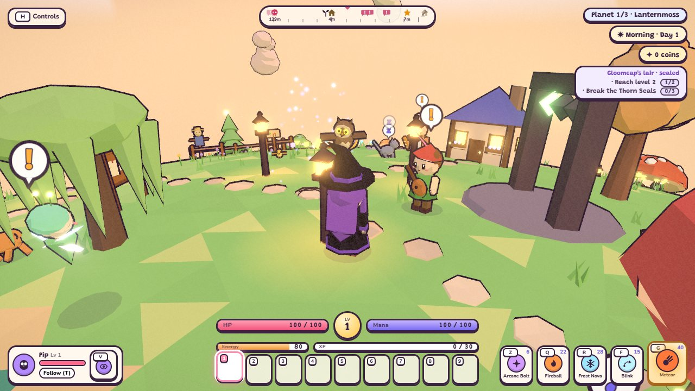
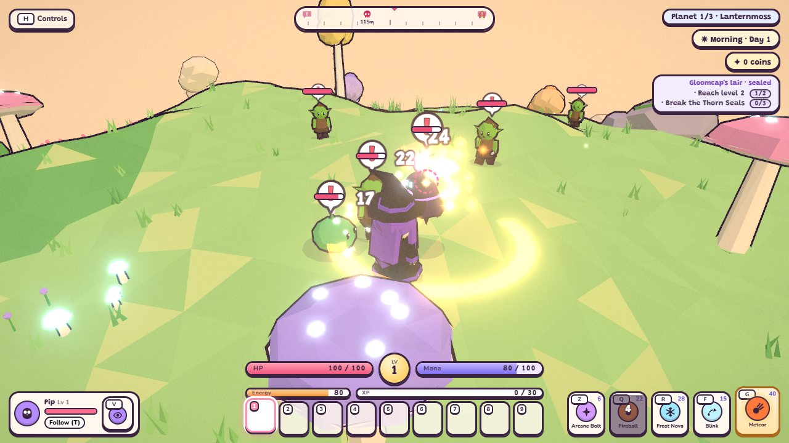
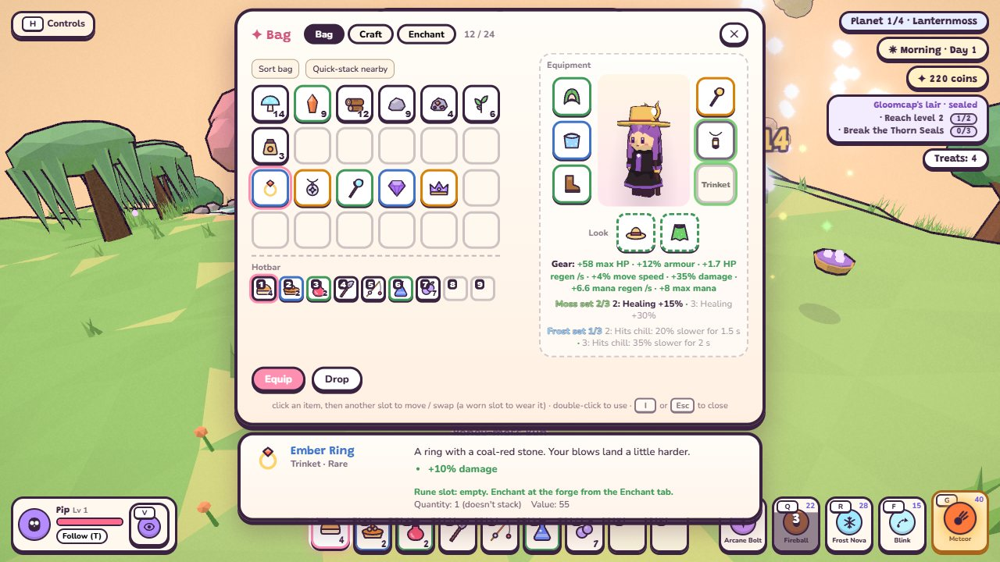
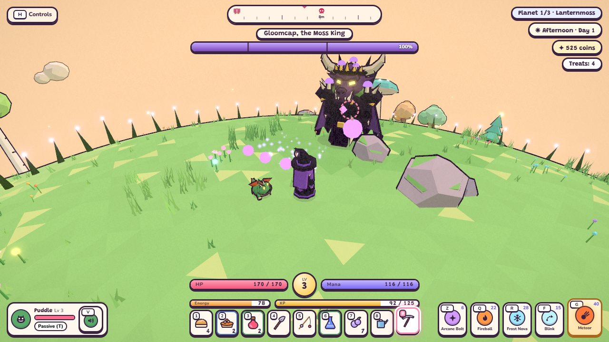

<div align="center">


# ✦ Lanternmoss ✦

### A little world. A little magic. A great big adventure.

*Where lanterns glow, moss grows, and adventures begin just beyond the village lights.*

[](https://tambayan-sa-nec.github.io/Lanternmoss/)
[](https://threejs.org/)
[](#-behind-the-magic)
[](https://tambayan-sa-nec.github.io/Lanternmoss/)

**🌿 Explore · 🗡️ Battle · 🏡 Build · 🐾 Befriend · ✨ Discover**

**[▶ Play the Game](https://tambayan-sa-nec.github.io/Lanternmoss/)** · **[📖 Game Wiki](docs/wiki/README.md)** · **[🧭 Feature Tour](docs/wiki/game-design/feature-tour.md)** · **[🗺️ Roadmap](TODO.md)**

*No download. No sign-up. Just step into the world.*

</div>

---

<div align="center">
  
  <sub>✦ Your journey begins beneath the village lanterns. ✦</sub>
</div>

## 🍄 Welcome to Lanternmoss

Somewhere among the stars floats a tiny, hilly world of glowing lanterns, mossy paths, and friendly critters.

Choose your hero. Meet the villagers. Wander beyond the warm light of home. Gather what you need, craft your equipment, grow stronger, and uncover the secrets hidden on the far side of each little planet.

**Lanternmoss** is a cozy **third-person action-adventure browser game** built with **Three.js** and plain JavaScript ES modules. Its models, icons, and sounds are generated in code rather than loaded from separate asset files.

There is a home to make your own, creatures to befriend, treasures to open—and monsters waiting beyond the village lanterns.

## 🧙 Choose your little legend

| 🧙‍♀️ Girl Witch | ⚔️ Boy Warrior | 🏹 Elf Archer |
| :---: | :---: | :---: |
| Magic and mischief | Courage and steel | Precision and agility |

Each hero brings **four abilities**, an **aimed ultimate**, and an individual **talent tree**. Find your favorite way to adventure.

## ✨ What awaits you?

| 🌱 Explore & Discover | ⚔️ Fight & Grow |
| :--- | :--- |
| Roam miniature spherical planets, discover resources, unlock treasure chests, and encounter friendly villagers. | Battle roaming monsters and mini bosses with directional combat and soft lock-on. Earn the right to face each world's boss. |
| 🏡 Make a Home | 🐾 Find Companions |
| Claim and furnish your cottage. Farm, fish, gather, craft, smelt, and enchant as you build a life in the village. | Raise pets that can level up, use abilities, follow commands, and fight alongside you. |
| 🏮 Meet the Village | 📖 Keep Your Story |
| Find quests, shops, enterable homes, a bounty board, and villagers following a day–night schedule. | Track achievements, creatures, and collections in your journal. Save your progress and capture moments with photo mode. |

<div align="center">
  
  
  
  <br />
  <sub>From tiny treasures to enormous trouble.</sub>
</div>

**Want a closer look?** Take the illustrated [feature tour](docs/wiki/game-design/feature-tour.md).

## 🌌 Three worlds. Three great challenges.

Each planet hides a sealed boss lair on its far side, signaled by a distant shaft of light. The boss waits until you have earned the encounter. Defeat it, claim its treasure chest, and choose where to go next at the village lantern gate.

| World | The challenge |
| :--- | :--- |
| 🌿 **Lanternmoss** | **Gloomcap**, the Moss King |
| 🔥 **Emberfall** | **Pyrrhax**, the Red Dragon |
| ❄️ **Frostveil** | **Malgrath**, the two-phase Winged Demon Lord |

Your adventure carries forward between planets: **level, equipment, inventory, coins, and pets** travel with you.

<div align="center">

**EXPLORE → GATHER → HELP → CRAFT → FIGHT → TRAVEL → REPEAT**

*The next little world is only one victory away.*

</div>

## 🗺️ The adventure is still growing

| Stage | Worlds / features | Status |
| :--- | :--- | :--- |
| **Public game — `master`** | Lanternmoss, Emberfall, and Frostveil, with campaigns, bosses, and mini bosses | **Playable** |
| **Integration — `develop`** | Gear sets, hero talents, local lighting, bounty board, photo mode, and Tidewhisper with its lighthouse, Mirelure and otter | **On `develop`; Tidewhisper release checks pass** |
| **Future destinations** | Duskhollow and the secret Lantern Moon | **Planned** |

> [!NOTE]
> Some features described above are available only on `develop` and might not yet appear in the public browser build. For the precise state of each feature, consult the [roadmap](TODO.md) and [changelog](docs/wiki/reference/changelog.md).

## 🛠️ Behind the magic

Everything in the game runs in the browser. Rather than relying on imported character models, audio files, or icon sheets, **the game creates its models, icons, and sounds in code**.

| Ingredient | Purpose |
| :--- | :--- |
| [Three.js r160](https://threejs.org/) | 3D graphics and rendering |
| Vanilla JavaScript + ES modules | Game logic and architecture |
| HTML + CSS | Menus, dialogue, and HUD |
| Node.js 18+ | Local server, built-in unit tests, and simulations |
| `three` (development dependency) | Gameplay simulations, matching the browser version |
| Optional `puppeteer-core` + Edge/Chrome | Browser smoke checks and screenshot capture |

The browser loads Three.js and the UI font from CDNs, so **an internet connection is required** even when using the local development server.

## 🚀 Run it locally

You will need **Node.js 18 or newer**. Because the game uses ES modules, open it through a local HTTP server—not directly via `file://`.

**1. Start the game**

```bash
npm start            # Launch at http://localhost:8080/
npm start -- 3000    # Or choose a different port
npm stop             # Stop this project's server on port 8080
```

Any static HTTP server works, including `npx serve` or `python -m http.server`. Three.js ships with the game in
`vendor/three/` and is declared in the import map in `index.html`, so play works offline; only the UI font still
comes from a CDN, and the game falls back to a system font without it.

**2. Run tests and simulations**

```bash
npm test             # Run unit tests (Node's built-in test runner)
npm install          # Install the development dependency once
npm run sim          # Run gameplay simulations and pacing audits
```

> [!TIP]
> Simulations can take several minutes. For individual simulations, balance reports, browser checks, or screenshot generation, see [Running, checks and screenshots](docs/wiki/technical/running-and-checks.md).

**Controls:** See the [full control reference](docs/wiki/reference/controls.md). Most keys can be reassigned in **Settings → Keys**; the number row and `Esc` are reserved.

## 🗂️ A peek inside the project

```text
Lanternmoss/
├── index.html                # Browser entry point and UI markup
├── styles/main.css          # HUD, menus, and styling
├── src/                     # Game code
│   ├── config/              # Tunable game data
│   ├── core/                # Core game infrastructure
│   ├── gameplay/            # Gameplay mechanics
│   ├── combat/              # Combat logic
│   ├── entities/            # Game entities
│   ├── world/               # World systems
│   ├── render/              # Rendering
│   ├── ui/                  # User interface
│   ├── models/              # Procedural models
│   ├── systems/             # Supporting systems
│   ├── items/               # Item definitions
│   ├── inventory/           # Inventory
│   └── progression/         # Player progression
├── tests/                   # Unit tests and tests/sim/
├── scripts/                 # Dev server, smoke checks, screenshots
├── vendor/three/            # Bundled Three.js r160 build and addons (no CDN needed)
├── docs/
│   ├── wiki/                # Game design, world, technical references
│   ├── screenshots/         # In-game screenshots
│   └── logs/                # Development work logs
├── TODO.md                  # Roadmap and task tracking
└── AGENTS.md                # Contributor and AI agent guidelines
```

For more detail, visit the [complete file map](docs/wiki/technical/file-map.md).

## 📚 The adventurer's library

| Document | What's inside |
| :--- | :--- |
| 📖 [Project Wiki](docs/wiki/README.md) | World, systems, game design, and technical details |
| 🧭 [Feature Tour](docs/wiki/game-design/feature-tour.md) | Illustrated guide to game features |
| 🎮 [Controls](docs/wiki/reference/controls.md) | Default keybindings and remapping |
| 🔧 [Running & Checks](docs/wiki/technical/running-and-checks.md) | Local workflow, simulation commands, and screenshots |
| 🗂️ [File Map](docs/wiki/technical/file-map.md) | Full project structure |
| 📝 [Changelog](docs/wiki/reference/changelog.md) | Major project updates |
| 🗺️ [Roadmap](TODO.md) | Planned and ongoing work |

## 🤝 Help the world grow

Contributions follow [AGENTS.md](AGENTS.md). Start a task branch from `develop`, run the relevant unit tests and simulations, and record each task in `docs/logs/`.

The project README is your doorway to Lanternmoss; the **wiki holds the detailed mechanics, rules, and design references**.

---

<div align="center">

### 🏮 The village lanterns are lit.

*Your adventure is waiting on the other side.*

**[✦ ENTER LANTERNMOSS ✦](https://tambayan-sa-nec.github.io/Lanternmoss/)**

<sub>Made of code, moss, and a little bit of magic.</sub>

<sub>I don't freakin know how this works. This is all vibe coded🤣🤣.</sub>

</div>
