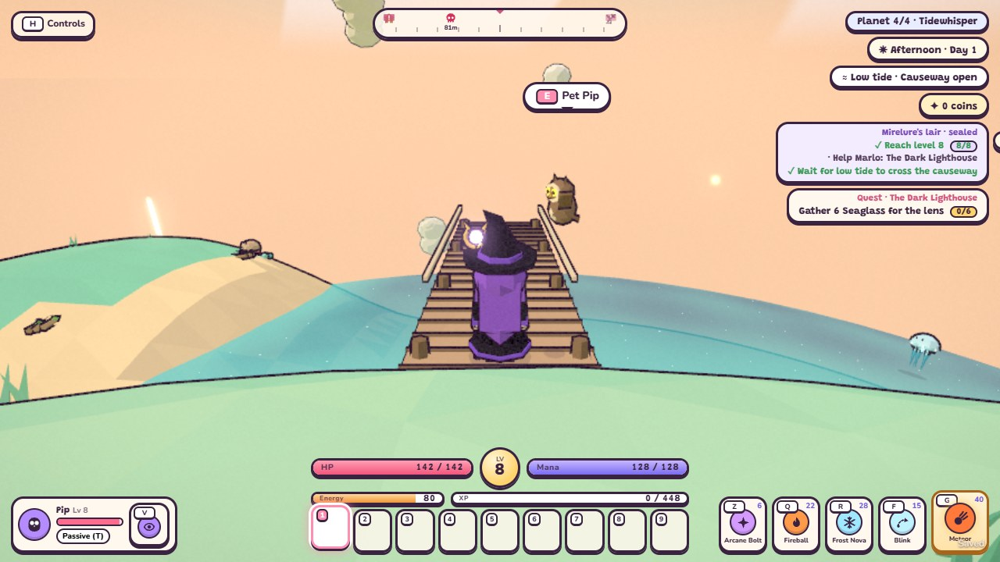
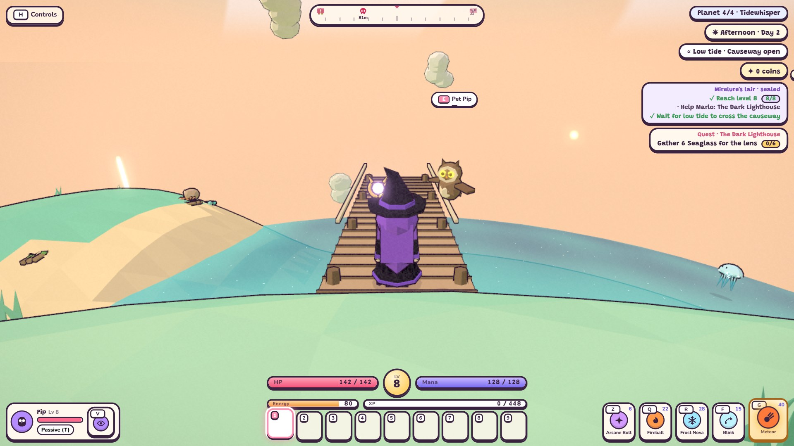

# Tidewhisper 27h: validation and hardware handoff

Status: **in progress / no-go**. Tidewhisper remains `released: false`. No release tag or `master` merge is authorized
by this checkpoint. The Iris Xe machine is expected to be accessible in about two days; no date or result is assumed.

The candidate harness activates the actual fourth catalog entry **before** importing Game, saves and achievements.
It preserves the three original worlds and exercises real `tidewhisper` ids, scaling, portal travel and Continue.
It lives under tests/scripts and is never imported by the production entry point. Borrowing an Act I save slot is
insufficient release evidence: those earlier fixtures inherited missing configuration and could hide schema issues.

## Current evidence

- Fixed the two reviewed Mirelure defects: bubbles and the real lure now share a clock; diving cancels pending and
  active surface attacks. The simulation observes actual bubble emissions and checks both roll states and a bite.
- Added explicit empty forage (coastal resources/washups supply gathering) and eight common/three Lantern chests.
  The content gate now rejects missing forage arrays. The actual fourth-world campaign simulation passed.
- Browser campaign check passed portal UI travel, partial quest/node Continue after a full reload, return travel,
  720p/1080p low rendering, the level/quest/tide gate, campaign completion and one Tide Crown after reload, without
  page/shader errors. It stages prior boss wins and the final kill; it is not an uninterrupted human playthrough.
- Full checks: 211 unit tests and all 43 simulations passed, including terrain timing. The corrected coastal bot
  also passed affected reruns on both seeds. The dedicated Mirelure browser check passed on rerun after one earlier
  real-lure bolt assertion failure; that failure remains recorded in the work log.
- [Available-hardware diagnostic](tidewhisper-performance.json): Intel UHD/ANGLE/D3D11, 120 samples per scene at
  1280x720 low. Latest village/night/squall p95: 24.8/27.5/31.0 ms. Latest peaks: 448 calls and 185,864 triangles.
  The earlier run peaked at 451 calls and 186,584 triangles; timing variation is retained in the work log. These are **not**
  Iris Xe results and do not meet the 16.67 ms timing target. Fixed-scene ceilings are 550 calls/230,000 triangles.
- **Duel balance passes** ([report](tidewhisper-balance.json), `--check`: 0 of 18 checked rows outside target, both
  seeds, all heroes). The check follows `docs/balance.md`: each boss/mini-boss fight, and each hero's regular-roster
  median (2-6 s; measured 3.6-5.6 s). Single monsters are reported but not checked, as the contract allows armoured or
  evasive types to run longer: Shellback takes 4.5-7.7 s. Changes, with no targets loosened:
  - Old Ironclaw was luck-dependent: four early wedges let one ranger fight end in 41 s. It now falls for the wet
    sand once per shell (later charges skid to a stop until its next shell), and its base HP is 800 (was 1000).
    All fights: 156-174 s (target 90-180).
  - Mirelure's base HP is 3250 (was 3000), lifting the ranger from 171-176 s to 188-191 s. All fights: 188-289 s
    (target 180-300).
- The [initial strict balance baseline](tidewhisper-balance-baseline.json) is kept as history: 12/30 rows outside
  target, recorded before the melee-bot correction (the knight bot used 1.8 m reach and oscillated between shore and
  target, so its Jellybell times of 16.3/24.2 s were a bot defect, now 3.2/3.8 s).

| Candidate at 720p low | Candidate at 1080p low |
| --- | --- |
|  |  |

## Reproduce the candidate checks

Use the feature branch, Node matching the repository requirements, and a fresh browser profile (the helpers create
their own). These helpers own ports 8114/8115 and leave normal player browser saves alone.

```powershell
git fetch origin
git switch feat/todo-27h-release-validation
git pull --ff-only
npm ci
npm install --no-save --no-package-lock puppeteer-core
npm test
npm run sim
node scripts/tidewhisper-campaign-smoke.mjs
node scripts/tidewhisper-balance.mjs --check
```

The balance reporter runs all three heroes on seeds 1 and 7 using the existing level-8, starting-equipment bots,
including approach/counter time and counted HP top-ups. It saves `docs/tidewhisper-balance.json` and exits nonzero
with `--check` if any row misses its target. Investigate the bot's approach, reach and counter behavior alongside
damage tuning; a large timing spread is not solved by blindly scaling HP. Do not loosen the targets to publish.

## Run on the Iris Xe machine

Run with other heavy work closed, browser hardware acceleration enabled and the intended graphics adapter active.
Commit candidate source changes first so the report identifies the exact code. `CHROME` can point to Chrome or Edge.

```powershell
$env:CHROME = 'C:/Program Files (x86)/Microsoft/Edge/Application/msedge.exe'
node scripts/tidewhisper-performance.mjs --release
```

The collector uses the actual fourth world, a 1280x720 viewport, Low preset, fixed village camera, daytime clear,
night clear and daytime squall. Each scene has 30 warmup frames and 120 measured frames. It records the browser's
actual WebGL GPU string, candidate commit, working-tree state, p95 frame interval and peak full-composer counts.

The browser paces frames at 60 Hz, and `--disable-gpu-vsync --disable-frame-rate-limit` have no effect, headless or
headed. An empty page in the same Edge measured a p95 interval of 16.8 ms (median 16.7 ms), already over a strict
16.67 ms. So the collector first measures that empty-page frame clock (240 frames) and records it as `frameClock`.
A scene passes if its p95 interval is no worse than max(16.67 ms, the empty-page p95). The clock only counts when
its median is a real 60 Hz (within 5% of 16.67 ms), so a 30 Hz display cannot loosen the budget. The content gate
applies the same rule (`frameLimitMs`). Per-frame CPU time of the game loop (`p95CpuMs`) and GPU time from timer
queries (`p95GpuMs`) are recorded as diagnostics only. They omit browser compositing and GC, and on the HD 4600
test machine they read up to 4 ms under the real interval, so they are never the pass number.

Default invocation (without `--release`) writes a diagnostic report only. `--release` writes
`docs/releases/tidewhisper.json` only if the candidate was clean, the actual renderer is Iris Xe and all scenes meet
the frame/draw budgets. A JSON file copied from another device or synthetic test data is not certification.

## Finish 27h

1. Done: duel timing bands pass on both seeds for all heroes, and the `pacing` audit now covers Tidewhisper's XP
   route, coin budget (new Tide forge fees, 280 coins) and two-day material yields (see `docs/balance.md`).
2. Obtain passing Iris Xe evidence for the final candidate. Re-measure after material rendering changes.
3. Enable the destination only after its full gate passes. Update release-dependent tests, title/portal/journal
   expectations, player-facing tour and affected screenshots. Recheck old v1 saves and the real travel/Continue path.
4. Run full unit/simulation suites and required browser checks on the synchronized feature branch. Do not merge or
   delete it while any required check fails. Publish to `develop` using the task workflow in `AGENTS.md`.
5. Record actual session cost, groundwork corrections and the final go/no-go. Do not approve Duskhollow or start
   optional otter work from this incomplete checkpoint. Request the separate release confirmation required by
   `AGENTS.md` only when the tested `develop` release is concrete and ready for `master`.

Work started at 2026-10-14 23:57 (machine clock); step/total durations and final check results are recorded in
[the 27h work log](logs/2610142357%20todo-27h-release-validation.md). Time waiting for external hardware is not
misrepresented as completed implementation or hardware-validation time.
