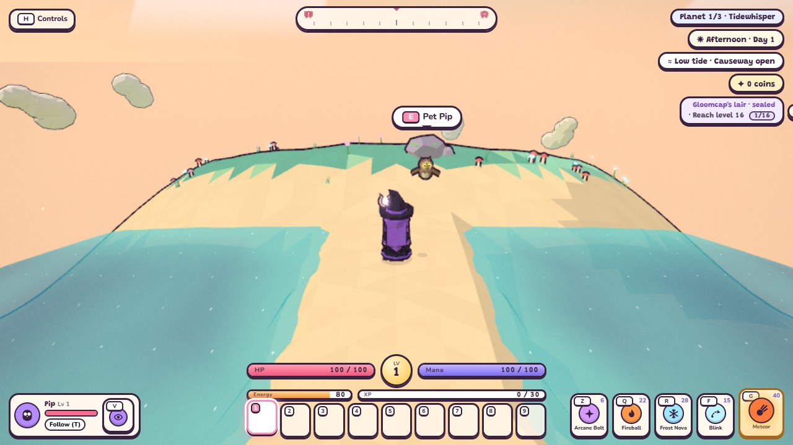
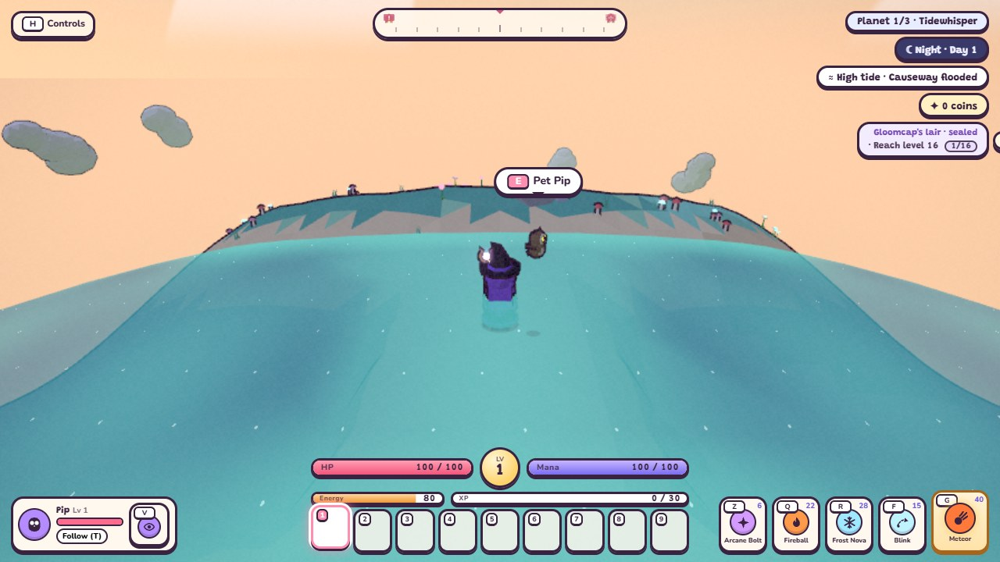
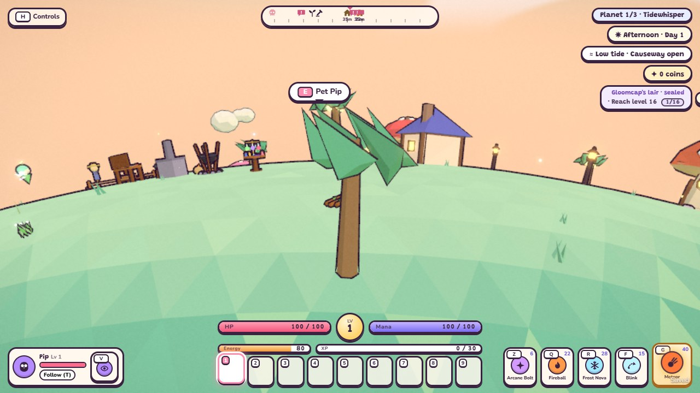

# Tidewhisper terrain and tides

TODOs 27a-27c implement the archipelago, water controls, coastal ecosystem, resources, weather and music. Tidewhisper remains
`released: false`: resources/weather/music, village and fights belong to 27c–27g, and campaign release requires 27h.
The development fixture borrows encounter/resource data in the original Lanternmoss save slot to exercise real
gameplay, Continue and portals. Those borrowed definitions are test-only and do not satisfy the content gate.

The config in `src/config/planets/tidewhisper.js` describes six islands, two connecting sandbars, a lagoon,
sea-green land, sandy shores, turquoise shallows, deep blue water and a peach/aqua sky. Terrain is baked once;
changing water never changes geometry or object ids. The largest island has raised village/house sites and a
reserved farm site. Scenery, grass, farm plots and nodes respect the declared high-water envelope. The actual
stilt houses, pier, interiors and lighthouse are still 27d.

| Development preview | Low tide | High tide |
| --- | --- | --- |
| Causeway |  |  |

`tides` is a registered mechanic. Its phase comes from the adventure calendar, with one smooth cycle per
300-second day: low at 40% (afternoon), high at 90% (night). Sea radius ranges from 71 to 72.5 metres, a total
1.5 m change. The causeway is dry at low tide and becomes deep enough to swim at high tide; swimming uses the
existing slower movement and extra energy drain. A chip beside the clock displays low/high/rising/falling tide
and whether the causeway is open. The phase freezes on title/pause, follows naps/sleep and calendar jumps, and
returns at the current calendar phase after travel. Time outside the game does not advance it.

The active instance exposes these controls for the later encounter stage:

- `status`: current level/phase/label, `causewayOpen` and `lagoonDrained`. Causeway availability is derived from
  the same live terrain/water query used by Walkers; it is not a separately saved unlock flag.
- `drainLagoon(seconds = 40)`: lower only the lagoon to radius 68.8 for a finite duration of at most one day.
  Invalid durations return `false`. Normal frames, time skips and away time expire the timer once.
- `refloodLagoon()`: cancel drainage and return the lagoon to the current tide immediately.

The lagoon is a bounded local spherical water region. Physics uses its own level instead of the surrounding
sea inside the region; the ocean shader cuts out that region and a matching cap renders its level. This lets
the exposed floor be walked on while the ocean and causeway retain their tide. The later Mirelure stage owns
boss triggers, gradual encounter reflooding, attacks and retries; 27a exposes no player-operated sluice or fight.

Only `{ drainRemaining }` is persistent, cleaned to 0–300 seconds in the existing optional v1 mechanic snapshot.
The controller supplies its calendar timestamp and away-time advancement. Save/Continue reconstructs the water
from config, saved timer and calendar before actor/resource placement. Travel/disposal removes both water meshes
and resets regions; no extra save owner or save-version bump is needed. Missing/malformed state defaults to a
normal, tide-filled lagoon.

Run `npm test`, `npm run sim`, and `node scripts/tides-smoke.mjs` with Puppeteer Core and Chromium (`CHROME`
overrides the executable). The browser helper owns port 8107, uses the low preset at 720p/1080p, checks actual
keyboard movement, swimming/energy, the chip, protected plots, local drainage, reload Continue and keyed portal
travel. It closes its own server/browser, refreshes the two development previews and keeps additional lagoon
captures in the temporary directory. `tests/sim/lib/tideFixture.mjs` is never imported by production code.

These checks verify this stage's rules and rendering; they do not certify the Intel Iris Xe 60-fps release
target. Population, content, balance, complete-world browser traversal and measured performance remain 27h's
requirements. Resources/weather/music are now implemented in 27c below; the next stage is 27d, village and lighthouse.

## Coastal flora and wildlife (27b)

The actual Tidewhisper config now selects lantern palms, kelp trees, coral fans, dune grass, sea thrift and sea
lavender. Palms carry glowing coconuts and can be chopped for wood through the existing axe/rest/regrowth flow.
Kelp leaves sway through one shared shader/time uniform; their batch bounds include the bend. Kelp and coral
are explicitly non-wood and refuse axe gathering, including direct gathering requests. Harvestable coastal
coral is gathered from exposed reef resource nodes with a pickaxe (27c).

Scenery is generated once with fixed upper counts: 18 palms, 12 kelp trees, 10 coral fans, 10 rocks and 120 small
plant clusters. Beach flora/animals reserve dry high water; kelp/coral and fish use shallow water. The static
scenery is spatially batched, and decorative quality changes do not change placement, resource ids or colliders.
The seeded development fixture measured **30,197 static scenery triangles in 65 batches**, including its borrowed
village. This is a geometry-cost check, not an Iris Xe frame-rate certification.

Three original ambient body builders cover crabs, turtles and seals. They share the Walker/animation/disposal
contract but are independent of combat enemies. Six hermit crabs scuttle at afternoon low tide and withdraw
into their shells when approached; flooded crabs head back to their dry home. Four sea turtles bask on beaches
by day and swim toward nearby shallows at night, then return to land. Three seals loaf on rocks, nap in the
morning/afternoon and bark when approached. The rare Pearl Turtle shares the turtle body with its own palette,
shell scutes and luminous pearl; it follows the existing slow-approach versus sprint-spooking rule.

Six ground birds alternate gull/tern plumage and wing/tail silhouettes, with one flying flock. Coastal birds
take off when flooded and keep flying until they find dry landing terrain. Three shallow shoals contain eight
fish each, plus eight emissive lanternfish visible at night: **32 fish in four instanced draws**. Fish follow the
same live sea/lagoon queries as movement, hide when water drains, freeze on pause, and dispose with their world.
They are ambient visuals; shore fishing and food are implemented in 27c, while the pier remains 27d.

Walk up slowly and press **E** to befriend the Pearl Turtle. Its first gift is the legendary **Pearl of the Deep**
charm, which adds armor and mana regeneration. The existing adventure-wide rare-gift ledger, inventory and
equipment owners persist it in v1 saves; no new save owner/version is added. Continue/revisits may allow a later
friendship reward, as with the original rare creatures, but cannot grant a second first-gift charm. Respawning
rebuilds the turtle's swimming destination at its new shore rather than retaining its old home.

Verify with both full suites and `node scripts/coastal-wildlife-smoke.mjs` (Puppeteer Core/Chromium; `CHROME`
overrides the executable). The helper owns port 8108 and exercises the actual config through
`tests/sim/lib/coastalFixture.mjs`, which production never imports. It checks 720p/1080p low rendering, real palm
gathering and **E** friendship, reload Continue, charm uniqueness and night visibility; refreshes the two previews;
and keeps crab/turtle/seal captures in the temporary directory. Schedules, day/night traversal, drained-water
hiding, respawn, equipped-charm saves, quality/placement invariance and disposal are also simulated.

## Coastal resources, weather and music (27c)

The actual config generates 54 deterministic nodes: driftwood (6), shells (6), seaweed (5), seaglass (6), salt
pans (4), clam beds (6), exposed coral reefs (5), shipwreck iron (3), pebbles (6), sweetleaf (5) and black pearl
beds (2). The far beach has a reserved low-water pearl shelf for the later Ironclaw encounter. Its guard is
still 27f. Clam/black pearl beds and coral require low tide and exposed ground. Coral needs a Stone Pickaxe;
shipwreck iron needs a Copper Pickaxe. Shell beds, coral branches, salt crystals and wreck planks have procedural
models; there are no extra lights. Farm plots remain above declared high water. Squall rain waters crops using
the existing farming rule; sea mist does not.

Driftwood gives wood. Shell washups give shells and seaglass; seaweed and glass have their own washups. Each
washup can be claimed once per high-water crest (90% of the adventure day). Its optional `claimedCycle` field
lives in the existing gathering v1 snapshot, even after the cooldown expires. A calendar skip exposes only the
latest batch; it never creates accumulated rewards. Continue and revisits preserve claims and requested node
ids. Earlier saves without the field default to an unclaimed node. World/quality changes do not add save owners.

With a rod on the hotbar, **E** near seawater fishes using the existing bite/reeling meter. Silver sprats are the
common coastal catch and golden koi remain rare. The float follows the live tide and cancels if its water dries.
At a cooking pot, make salted fish (sprat + salt), seaweed rolls (seaweed + sprat) and coastal chowder (clams +
sprat + salt). At a forge, craft the Tide Circlet, Mantle and Boots from glass, pearls, coral and shells; a Tide
Pendant uses a black pearl, glass and shells. These pieces use the existing equip/save/stat rules and are
explicitly crafted, so they cannot leak into Act I random gear rewards. Their set identity is recorded; bonuses
remain TODO 28a.

Sea mist begins at dawn and clears later in the morning. Squalls blend driving rain and strong wind into the
existing weather layers and add shader whitecaps to the ocean/lagoon, without changing the tide. The sea waltz
uses a 720 ms beat in three, over a gently modulated procedural pad. Theme changes retune existing pad voices and
replace the single melody timer; travel and repeated switching do not accumulate loops. Battle music retains
priority. The original worlds keep their cozy score.

Run both full suites and `node scripts/coastal-resources-smoke.mjs` (Puppeteer Core/Chromium, `CHROME` override).
The helper owns port 8109 and borrows only test encounters in `coastalResourceFixture.mjs`; it exercises real
E gathering, reload Continue, the three-beat audio timer, 720p/1080p low squall shaders and dry farms. Captures
are saved in the temporary directory. The simulation also covers pick tiers, low/high tide, multi-day skips,
revisits, sea fishing, dawn transitions, crop watering and equipped Tide gear Continue. These checks do not certify
Iris Xe frame time; that hardware measurement and campaign release remain 27h.
