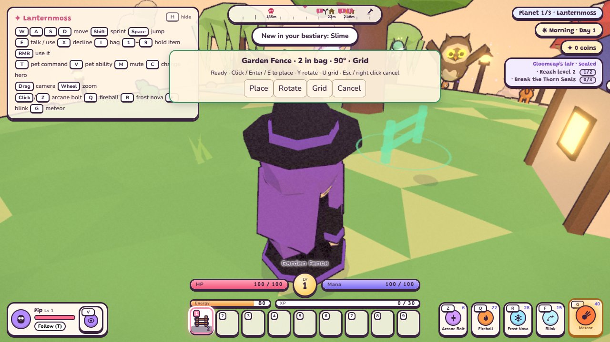
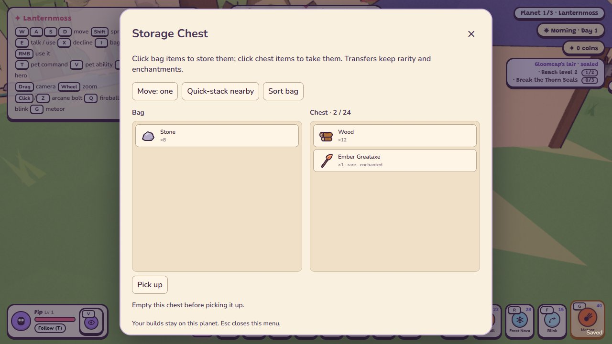

# Building your garden (TODO 25b)

Craft a piece in the bag's **Craft** tab, then use it from the bag or hotbar while outside. Cottage furniture
also works outdoors; inside your claimed cottage it still fits the five established furnishing spots.

A translucent model shows the ground position and facing. **Green** means ready; **red** explains what prevents
placement. Point at nearby ground, or leave the cursor off the world to aim four metres ahead of your hero.
Walk or drag the camera to adjust your view. Building keeps combat input off until you finish or cancel.

| Control | Action |
| --- | --- |
| Click, Enter or E | Place the preview; consumes one piece only after checks pass |
| Y | Rotate 90 degrees |
| U | Toggle the planet's fixed grid and free ground placement |
| Esc or right click | Cancel without spending the item |
| E beside a placed piece | Open its paused management menu |

Y, U and E can be remapped in Settings > Keys. The preview lists the current bindings. Use **Place**, **Rotate**,
**Grid** and **Cancel** buttons for mouse controls. If another piece remains, the preview stays open for the next
placement. Its current position becomes invalid while occupied, so move the cursor before placing again.

Keep the village square, generated paths/scenery, doors, lantern gate, standing stones, village farm/crafting
corner, water and boss/mini-boss lairs clear. Placement also rejects steep/uneven ground, other pieces, people and
creatures. Move within eight metres and step out of the footprint. Solid furniture, fences, chests and stations
block walking and the follow camera; rugs, stepping stones and plots are walk-through. Pieces sit on sampled
ground, reserving enough space for their model; fences reserve a thin rotated rail footprint. Each planet allows
up to 256 pieces. Modular floors, wall/door/window panels and roofs are implemented in [TODO 25c](structures.md).

## Pieces and acquisition

Every piece has a recipe known from the start, usable by every hero, without a coin charge.

| Piece | Materials | Made at |
| --- | --- | --- |
| Patchwork Bed | 8 Wood + 4 Sweetleaf | Workbench |
| Round Wooden Table | 4 Wood + 2 Stone | Workbench |
| Rosewoven Rug | 6 Sweetleaf + 2 Moonberry | By hand |
| Cottage Lantern | 3 Wood + 1 Copper Ingot + 2 Glowcap | Workbench |
| Potted Sweetleaf | 3 Sweetleaf + 2 Stone | By hand |
| Garden Fence | 3 Wood | Workbench |
| Stepping Stone | 2 Stone | By hand |
| Storage Chest | 8 Wood + 1 Copper Ingot | Workbench |
| Garden Workbench | 12 Wood + 4 Stone | Workbench |
| Garden Forge | 12 Stone + 4 Copper Ingot | Forge |
| Garden Cooking Pot | 6 Stone + 2 Copper Ingot + 4 Wood | Workbench |
| Garden Brewing Stand | 8 Wood + 2 Copper Ingot + 3 Glowcap | Workbench |
| Farm Plot | 4 Wood + 2 Stone | By hand |

Lanterns glow; up to four nearby lanterns cast warm local light at once. Use **Rest in bed** to nap or sleep to morning with the same health,
resource and energy recovery as your cottage bed. Placed stations support the usual crafting, smelting and
forge enchanting. Choose **Open Craft tab** and stay near the station. Farm plots use the ordinary hoe, seeds and
watering can, rain watering, daily drying and crop growth; choose **Tend this plot** or use the tools from the
hotbar. Plots grow only while you play on their planet, including time skipped by sleeping.

## Storage, sorting and pickup

Each storage chest has **24 stacks**. Press E beside it to open a paused storage menu. Click a bag stack to
store it, or a chest stack to take it. **Move: stack / one** changes the requested quantity. Transfers move only
what fits; they preserve gear rarity and enchantments and leave the remainder in its source. You may explicitly
store hotbar items; quick-stacking leaves them with you.

**Quick-stack nearby** moves bag items into chests within 2.6 metres that already contain the same item with the
same properties. It fills matching stacks and spare slots, and can use several nearby chests. Unmatched items
stay in your bag. This button is also available in the bag window.

**Sort bag** groups items by category and name, combining compatible stacks. It keeps all nine hotbar slots and
individual gear properties in place. Sorting emits no collection rewards. Both storage and bag windows offer it.

**Pick up** returns the whole crafted piece. A full bag leaves the piece in place. Empty a chest first; harvest a
planted plot first. Picking up clears its model, movement/camera colliders, station access and plot registration.
You can then place it somewhere else. Paused menus support Tab/Shift-Tab focus, Space/Enter buttons and Esc close.

## Saves and verification

The version-1 registry adds a `building` snapshot per planet: bounded piece IDs, item IDs, normalized surface
directions, quarter-turn rotations, storage stacks and plot state. Cottage ownership remains separate. Leaving
and returning, Continue, and save import/export preserve builds. Older saves have no outdoor pieces; a fresh
adventure clears them. Placement, pickup and storage changes autosave through the existing error reporting.
Transient previews and open menus are discarded. Import cleaning rejects unknown items, duplicate IDs and invalid
directions, bounds quantities/crop growth and preserves only supported item properties. Restoration rechecks
permanent-site footprints against regenerated terrain while ignoring actors that may have moved.

Run `npm test` and `npm run sim`; focused checks are `npm run sim -- building home houses save portals stations`.
The building simulation checks actual crafts, all 13 pieces, rotated fence colliders and camera blocking,
protected ground, safe storage/full-bag pickup, preview cancellation, working placed stations and crop tools,
bed recovery, separate builds on all three worlds, Continue, legacy saves and cleanup.

Optional browser verification: `node scripts/building-smoke.mjs` with locally installed `puppeteer-core` and
Edge (or `CHROME` pointing at Chromium). It owns a temporary server on port 8101 and closes it on completion.
It checks real hotbar/rotation/grid/confirmation/cancel keys, green/red previews, E management, storage transfer
buttons, focus, viewport bounds, screenshots and page-reload Continue.
