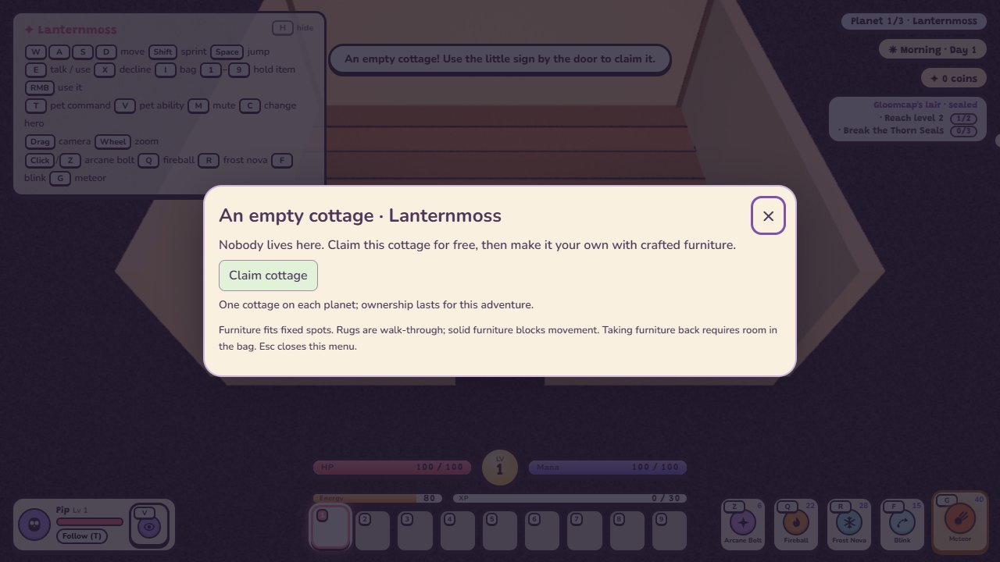
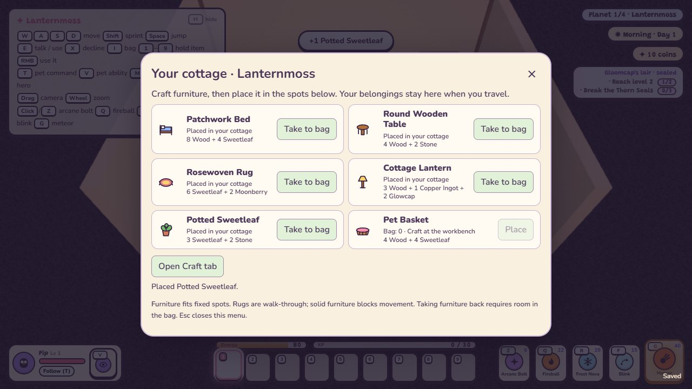
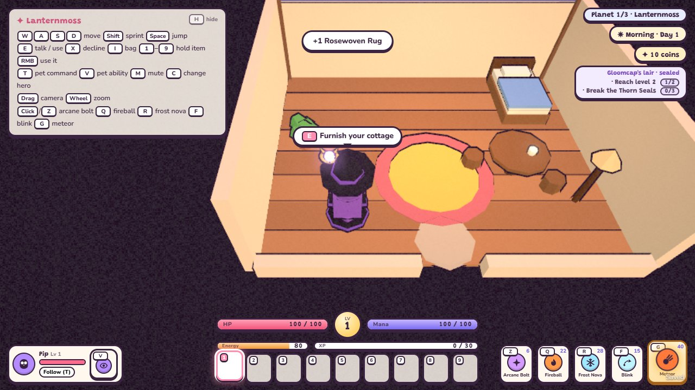

# Your cottage (TODO 25a)

Each village has a separate **empty cottage**, marked on the compass. Enter with **E**, walk to the small sign
beside the door, and press **E** to claim it for free. The sign opens a paused furnishing menu; **Esc** closes it.
Claiming does not take anyone else’s home. Cinder, Tuva and the other residents keep their original houses.

Craft furniture in the bag’s **Craft** tab, bring it to your cottage, and choose **Place** at the sign. Furniture
can also be used from its bag slot or hotbar while inside a claimed cottage. Each piece fits one fixed spot;
outdoor placement and rotation are available through [building previews](building.md).

| Furniture | Materials | Made at |
| --- | --- | --- |
| Patchwork Bed | 8 Wood + 4 Sweetleaf | Workbench |
| Round Wooden Table | 4 Wood + 2 Stone | Workbench |
| Rosewoven Rug | 6 Sweetleaf + 2 Moonberry | By hand |
| Cottage Lantern | 3 Wood + 1 Copper Ingot + 2 Glowcap | Workbench |
| Potted Sweetleaf | 3 Sweetleaf + 2 Stone | By hand |
| Pet Basket | 4 Wood + 4 Sweetleaf | Workbench |

The recipes are known from the start for all three heroes and have no coin cost. Placing consumes one crafted
item. **Take to bag** returns it; if there is no room, the furniture stays put. An occupied slot, an unclaimed
cottage, another villager’s house, a hero standing in the solid piece’s spot cannot consume
an item. Beds, tables, lamps, plants and the pet basket block indoor movement; rugs are walk-through.
With six pieces the furnishing menu lists them in two columns, so it still fits a 720p screen without scrolling.

The **Pet Basket** (TODO 35) is where your pet naps while you are home: it heals there, and a fainted pet recovers six
times faster. **E** by it checks on your pet. See [pet care](pets.md#pet-care-todo-35).

Press **E** by your placed bed to rest. A night’s sleep reaches the next morning and fills health, mana/stamina/focus
and energy. A daytime nap advances the clock by 20 seconds and recovers 40% of each maximum, capped at full.
Existing watered-crop overnight growth still applies. Rest autosaves once its fade has finished; a fainted hero
cannot use the bed.

## Persistence and implementation

Each planet saves its own `home: { claimed, furniture }` snapshot in the existing version-1 planet registry.
Only known, unique furniture item IDs are accepted, and unclaimed homes have no furnishings. Portal returns,
Continue and save-file import/export retain ownership, decorations and an indoor hero’s position. Old version-1
saves load with an empty, unclaimed cottage; a new adventure clears all homes. Claiming and furniture changes
autosave, following the existing save-error handling.

House indices **0–5** are preserved; the separate cottage is **6**. Its exterior is placed after the existing
population with checks for terrain, ponds, colliders, the gate, farm and crafting corner. It does not reorder
the original world seed placement. The home owns and disposes its exterior; the house controller owns the room.
Updating furnishings rebuilds that room while preserving the hero’s position and facing.

Integration also fixes validation of indoor chest/lore/oven IDs: `HOUSES` is an object, so testing against its
nonexistent `length` discarded those snapshots. Only canonical IDs that exist in the config now survive cleaning.
Indoor collision resolution also handles a hero exactly at an object’s centre. Rugs are raised above the floor
surface so their colours remain visible.

Outdoor storage, fences, paths, stations, farm plots and placement previews are implemented in [TODO 25b](building.md). You can also build [modular outdoor shelters](structures.md).

## Verification

Run `npm test` and `npm run sim`. Focused gameplay checks: `npm run sim -- home houses save portals crafting`.
The home simulation exercises real crafts, bag/hotbar placement, removal with a full bag, collisions, both rest
modes, separate homes on all three planets, indoor Continue, original house memory, old saves and fresh resets.
Optional browser check: `node scripts/home-smoke.mjs` (locally installed `puppeteer-core`, Edge or `CHROME` pointing
at Chromium). It uses real door/sign/button/keyboard interactions, crafting, furniture edits, beds with all three
heroes, indoor reload, portal return and 720p/1080p layout checks, and records screenshots and browser errors.
