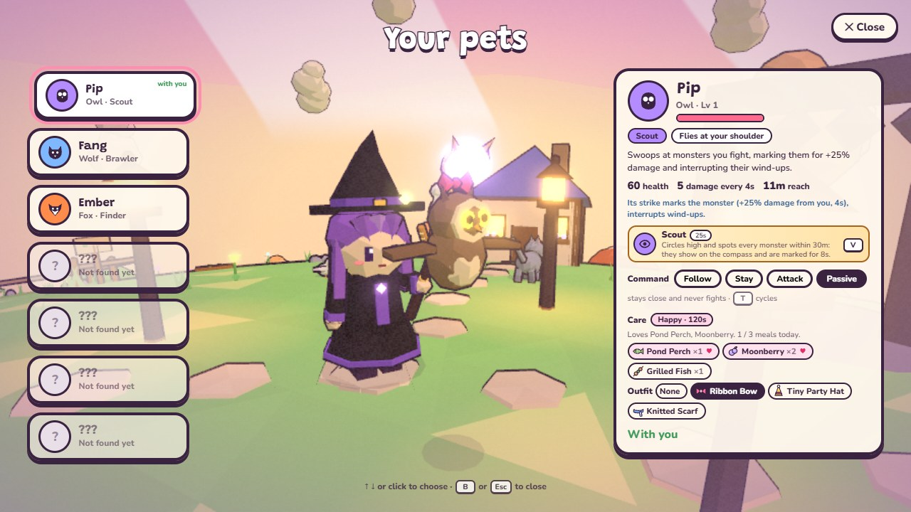
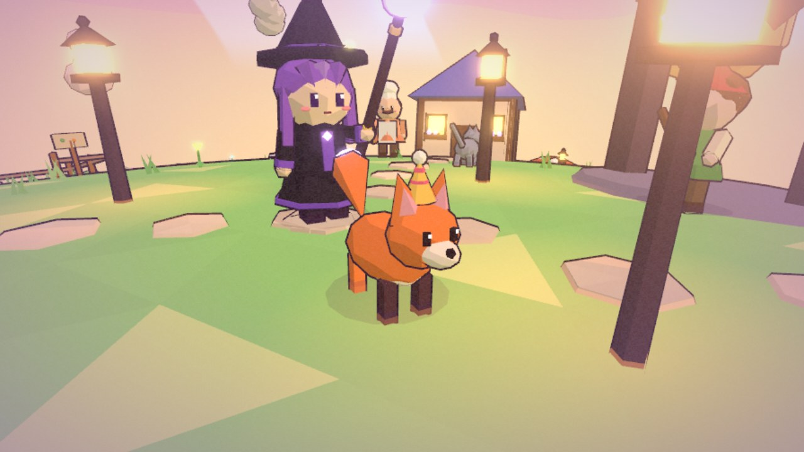
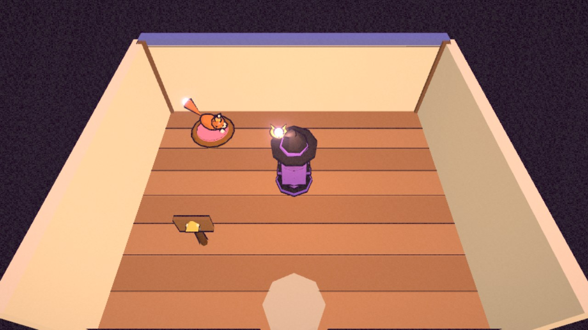

# Pets

`config/pets.js` defines every pet: its body (`fly`: owl, wisp, dragon whelp; `walk`: wolf, fox, otter), attack, ability,
health and how it's unlocked. `gameplay/Pets.js` owns what outlives one pet body (bodies are rebuilt after travel, a
house or a swap): which pets are unlocked and which one is out, names, the command, health and fainting, the ability
cooldown, and which pet each hero last took (`gameplay/petPicks.js`, in localStorage). Bodies (`entities/companions/`) ask it what to do; `petBrain.js` picks targets by command and lands hits
(`source: 'pet'`, which also earns XP). Pet level = hero level. Unlocks listen on `core/events.js` (`questcomplete`,
`chestopened`), so quests and chests don't know pets exist. Pets are chosen on the pet step of character select and in
the pet menu (`ui/PetMenu.js`, which pauses the world; bodies then idle through `pose(dt)`); both screens share
`ui/petViews.js`, and `Pets.presenting` brings the pet round in front of the hero for the camera. A new pet = an entry in `PETS`, a model (a critter look or
a flyer builder), an ability handler in `gameplay/petAbilities.js` and two glyphs in `ui/icons.js`; `npm test` checks
all of that is in place.

The Tidewhisper otter unlocks when The Dark Lighthouse is completed. **Pearl Dive** (`V`) works beside a submerged,
ready clam bed in Tidewhisper: the otter dives, spends that bed and brings back one pearl. Its 90-second cooldown and
two successful dives per in-game day cap the extra yield. A dry, spent or out-of-range bed gives no pearl and spends
no cooldown. The daily count and cooldown survive Continue and travel; a new day renews the count. Tidewhisper and
its otter remain unavailable in normal play while the world is unreleased. Candidate tests expose both without
changing the release flag.

## Pet care (TODO 35)

The pet menu (`B`) has a **Care** section for the pet that is out with you. The numbers live in `config/pets.js`
(`PET_FAVOURITES`, `PET_FOOD`, `PET_FINDS`, `PET_OUTFIT_FIT`, `PET_BED`); the runtime is in `gameplay/Pets.js`.

- **Feeding.** The Care section lists the food in your bag, favourites first (marked with a heart). Each pet loves two or
  three foods, from the farm, the ponds and the wilds: the owl loves pond perch and moonberries, the wolf ice trout, moon
  carrots and honey buns, and so on. A pet eats any food you could eat yourself (anything that fills energy: not potions), plus the raw crops, fish and forage on
  those lists. Every meal takes one food from the bag, restores 30% of the pet's health and gives you a little XP
  (5, or 15 for a favourite). A favourite also makes the pet **Happy** for 120 s: +20% pet damage. A pet eats three
  meals an adventure day; after that it is full until tomorrow. Only the pet that is out with you can be fed.
- **Finds.** A pet fed today sometimes brings back something it found while you explore together outdoors: every 75 s
  it follows you outside a fight, there is a 40% chance of sweetleaf, moonberries, a glowcap, seeds or a few coins.
  It finds at most three things a day, and an unfed pet finds nothing.
- **Outfits.** A Ribbon Bow, a Knitted Scarf and a Tiny Party Hat are crafted by hand in the Craft tab's **Vanity**
  group, like the hero's flower crown. Pick one in the Care section to put it on any pet you have found: it leaves the
  bag while worn, is drawn on that pet's head (`models/vanity.js` `dressPet`, placed for each body by
  `PET_OUTFIT_FIT`), stays with that pet when you swap, and comes back to the bag when you choose **None**.
- **The pet basket.** A Pet Basket is cottage furniture (4 Wood + 4 Sweetleaf at the workbench). Placed in your
  cottage, it shows your pet asleep in it, outfit and all, whenever you are home. While you are there the pet heals
  25% of its health a second, and a fainted pet's rest runs six times faster. **E** by the basket checks on it.
  Placed outdoors as a garden piece, the basket is only decoration.

Meals today, the Happy timer, today's finds and each pet's outfit are saved with the pets and survive Continue and
travel; the save cleaner clamps meals and finds to their daily limits and drops anything that is not a real outfit on
a real pet.

| The Care section | Dressed up | Asleep in the basket |
| --- | --- | --- |
|  |  |  |

Checked by `tests/petCare.test.mjs` (favourites and finds are real and bounded, every pet has an outfit fit, saves stay
sane), `tests/sim/petCare.sim.mjs` (feeding, the daily limit, finds on the pet's own timer, outfits through a swap, the
basket's healing and a Continue) and `node scripts/pet-care-smoke.mjs` (port 8146; a real `B`, real clicks to feed and
dress, a real `E` at the basket, 720p/1080p, zero page and shader errors).
