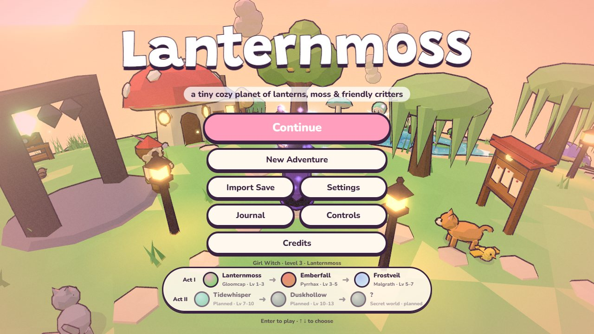
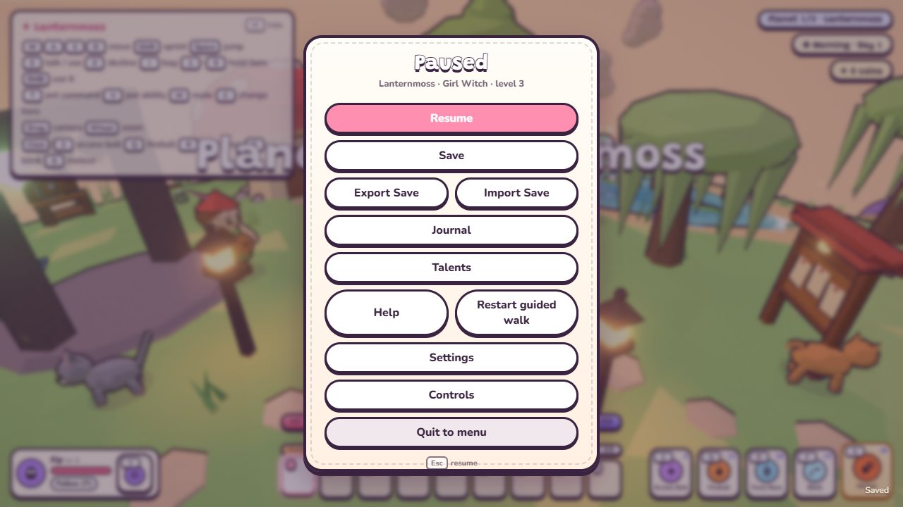

# Saving an adventure

  
  

The browser keeps one adventure. Choose **Continue** to resume, or **New Adventure** to replace it after confirmation.
Autosave runs every two minutes of play, on arrival, after a boss and before quitting. **Save** in the pause menu
writes immediately; the small **Saved** note confirms success. **Export Save** downloads a JSON copy; **Import Save**
validates a file and asks before replacing the slot. Export copies to keep multiple adventures or move between devices.
Browser storage must be available; clearing it removes the slot. Settings, keys, the journal and pet preferences are
separate. Format, state ownership and compatibility checks: [docs/wiki/technical/save-format.md](../technical/save-format.md).
