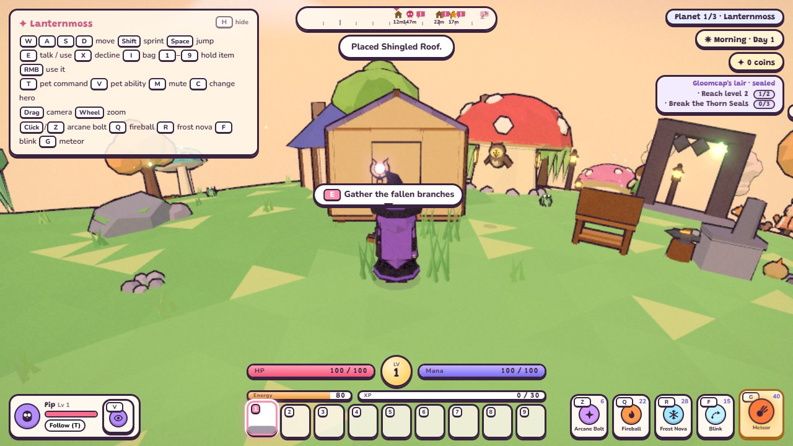
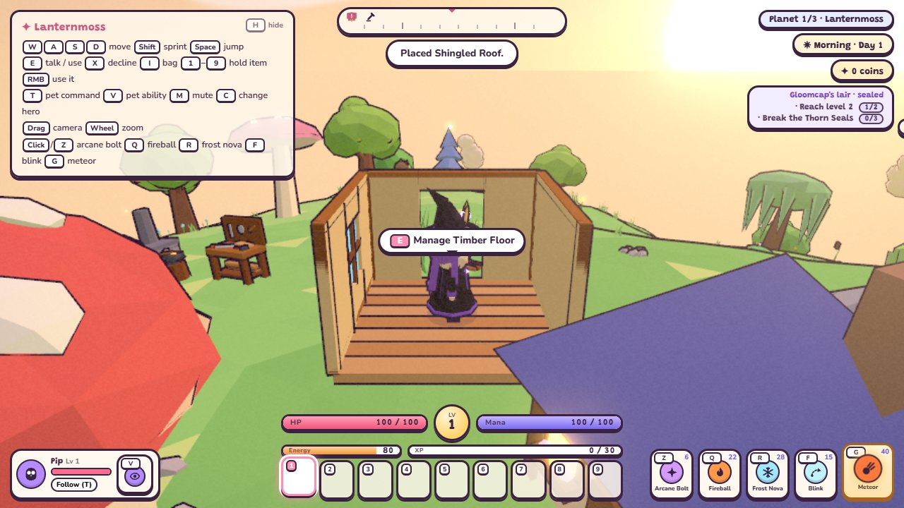

# Build a shelter (TODO 25c)

Craft floors, panels and roofs at a workbench, then use them from your bag or hotbar outdoors. The existing
building preview shows green or red ground, explains refusals and consumes one item only when placement succeeds.
**Click / Enter / E** places, **Y** rotates, and **Esc / right click** cancels. These pieces add a shelter you can
walk into through an open doorway, in the same outdoor world.

| Piece | Materials | Purpose |
| --- | --- | --- |
| Timber Floor | 8 Wood + 4 Stone | A 4 by 4 metre foundation tile |
| Timber Wall | 6 Wood + 2 Stone | A solid wall along a floor edge |
| Timber Doorway | 6 Wood | A panel with a 1.5 metre open doorway |
| Timber Window Wall | 6 Wood + 2 Glowcap | A solid panel with a glowing window |
| Shingled Roof | 8 Wood + 4 Sweetleaf | A roof supported by opposite walls |

All five recipes are known from the start for every hero, use first-world resources and cost no coins.

## Put the pieces together

1. Point a Timber Floor preview at clear, fairly level ground. Rotate the first floor to choose the foundation
   heading. Village paths, squares, doors, water, crafting/farming corners, lairs, scenery and occupied spots
   keep their existing protection.
2. Point beside that floor to add another tile on its grid. Tiles must share an edge and remain connected. All
   tiles in the foundation share one plane and heading, keeping their seams aligned on the round planet.
3. Point a wall, doorway or window preview at a floor. Y selects one of its four edges. A shared edge accepts one
   panel, even if approached from the neighbouring floor. Doorways stay open for walking through.
4. Place walls on two opposite edges, then point a roof preview at the floor. A doorway or window counts as a wall
   support. Y turns the roof ridge; each floor accepts one roof. Choose matching ridge directions on adjacent tiles.
5. Add furniture, lanterns, storage chests or crafting stations where they fit on a floor. Use free ground mode
   (U) for fine adjustments. Their models inherit the foundation height and heading. Farm plots stay on soil.

U toggles the world grid for a new foundation and ordinary decorations. Connected tiles, panels and roofs always
snap to the foundation grid. Attached floors keep its original rotation. The preview identifies that grid and
gives piece-specific instructions.

A foundation is ground level, bounded to five tiles per side, and uses short supporting posts. Terrain must stay
below its common plane and within 0.65 metres of it; rising ground, excessive slope, larger drops, water and
obstructions prevent extension. Leave space around the first tile if you plan to expand. Start a separate
foundation farther away when the terrain or size limit prevents joining. The existing 256-piece limit per planet
includes structure pieces. Upper storeys, stairs and a separate indoor house instance are outside this version.

## Walk inside and manage your home

Floors support walkers continuously, including their square edges and shared seams. Walls block movement and the
camera; the doorway opening stays traversable. The roof underside stops upward jumps. While you stand within a
foundation, its roofs and camera-facing panels cut away so you can see the hero and floor. They return on exit.
The cutaway keeps floor support, wall movement collision and roof ceilings active.

Use E beside a piece to open its paused management menu. A floor lists its attached panels, roof, furniture and
storage; choose one to manage it. An attached piece links back to its support floor. Buttons farther than the
usual interaction reach are disabled until you move closer. Menus support Tab/Shift-Tab focus, Space/Enter
activation and Esc close.

Pick up returns the crafted piece if the bag has room. Empty chests and harvest plots before pickup, as before.
For structures:

- Step off a floor and remove its attached contents before taking it.
- Keep the remaining floor tiles connected. Dismantle outer tiles before their bridge tile.
- Remove a roof before taking away its last opposing wall support pair. If another opposing pair remains, the
  redundant wall may be removed safely.
- The first foundation tile must remain until its connected floors and supported pieces are dismantled.

Your built shelter remains in the outdoor simulation: time, weather, companions and combat continue normally.
Use an installed bed to rest, a chest to store items, or your stations to craft as described in
[building and storage](building.md). The village's separately claimed cottage remains available too.

## Saves and verification

Structures extend each planet's version-1 `building` records with support IDs and integer floor cells. The first
floor owns its direction and heading; connected cells, panels, roofs and decorations refer to that foundation or
their support floor. On load, the shared plane is rebuilt from the same generated terrain, and dependencies are
restored before their contents, regardless of save-array order. Invalid, disconnected, overlapping or unsupported
records are rejected. Saved hero positioning uses the actual support height, so Continue keeps you on the floor.
Camera cutaways, previews and menus are transient; ordinary 25b builds and older version-1 saves still load.

Portal round trips, Continue and import/export preserve each planet's shelter and storage. New adventures clear
all pieces, support/camera colliders and registrations. Placement, pickup and storage use the existing autosave
and save-error handling.

Run `npm test` and `npm run sim`. Focused checks: `npm run sim -- structures building terrain save portals`.
The structure simulation covers actual crafting, attachment refusals, seams, floor support, door movement,
wall/camera collision, roof ceilings and cutaways, dependency-aware pickup, decorations/storage, unordered
restoration, independent shelters on all three planets, old saves and reset cleanup.

Optional browser check: `node scripts/structures-smoke.mjs`, using locally installed `puppeteer-core` and Edge
(or `CHROME` pointing at Chromium). It creates a temporary server on port 8102 and closes its browser/server on
completion. It checks real preview/rotation/placement keys, attachment management, pickup refusals, doorway
movement, cutaway/exterior views, 720p/1080p bounds and page-reload Continue, and captures the images above.
