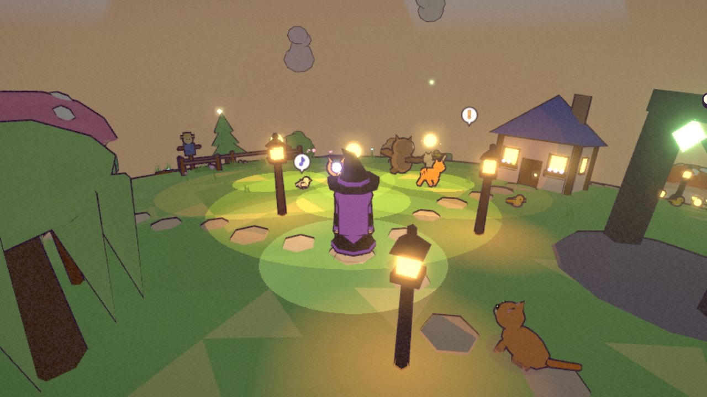

# Local light (TODO 29a)

Dark places (the caves of 29b-29g and Duskhollow in 30) need light that follows the hero and pools around lanterns,
without dozens of real lights. `src/render/lighting.js` adds two layers, tuned in `RENDER.localLight`
(`src/config/render.js`):

- **Light radii in the toon shader.** Every `MeshToonMaterial` (patched on its prototype, so cached materials and
  clones too; the swaying grass and kelp, which have their own patches, chain it) reads up to 8 light spots from shared
  uniforms and adds stepped light inside each radius: full light inside half the radius, a 35% band out to its edge.
  It is scaled by the place's `darkness`, so on the open surface (darkness 0) nothing changes. In the dark nothing lit
  falls below `minAmbient` (20%) of its own colour, so shapes and the ink outlines stay readable.
- **A pool of four real point lights**, created once and shared. While any `real` source is within 12 m of the hero,
  all four are on (unused ones at zero intensity) and light the nearest real sources. When none is near, all four go
  off together. The light count therefore changes only between 0 and 4, never one lamp at a time (each change
  recompiles every lit shader). Indoors the pool is off; a house interior keeps its own single light. So at most four
  real point lights are ever lit.

`LocalLights.setDarkness(d)` (0 surface, 1 a cave) dims the sun and sky light to `dimFloor` (12%) and draws the sky and
fog at `skyFloor` (30%). While it is dark the hero carries a light (radius 5 m). Sources are added with
`LocalLights.add({ at, radius, color, intensity, real, outdoor })` and removed with the returned handle's `remove()`.
`at` is a live position or a function. The nearest 8 sources to the hero get the shader spots. Home lamps
(`gameplay/Building.js`) are the first real sources, at the same brightness as before.

Changing the darkness never compiles a new shader program: every toon material has one variant with the light radii
built in and switched by a uniform.

## The harness and checks

There is no cave yet, so the harness is the Lanternmoss village at night with darkness 1 and three glowing lanterns
(bloomed, each a real source).

- `node tests/sim/lighting.sim.mjs`: the patch lands before the toon output in the real three.js 0.160 shader (a
  chunk rename in a three.js update would fail it), on every toon material, clones, grass and kelp, with one cache
  key. At darkness 0 nothing changes. In the dark the lights dim to the floor, the hero carries a light and the nearest
  8 of 13 sources get the spots. The pool switches 0 or 4 together and is off indoors. Sources go with their owners and
  on travel.
- `node scripts/lighting-smoke.mjs` (Edge, port 8123): every patched shader compiles in real WebGL with zero shader
  errors, and darkness 0 → 1 → 0 compiles no new program. On Low and High the ground under each lantern is clearly
  brighter than unlit ground, which stays readable (luminance 27-55 of 255, not black). The pool switches together,
  and 720p/1080p show zero page errors. It retakes the shot above.
- `tests/sim/building.sim.mjs`: every home lamp is a source; at most four real point lights.

## Performance

The shader adds a uniform branch to every toon fragment (skipped at darkness 0) and up to 8 distance tests in the
dark. It adds no draw calls or triangles. `scripts/performance.mjs --quick` was rerun on this machine (Intel UHD,
SwiftShader in headless runs). Its ceilings passed and its timings are diagnostics only. As for every rendering
change, real certification needs Iris Xe hardware (`docs/wiki/technical/performance.md`), and the dark harness should be measured
there before Duskhollow ships.
