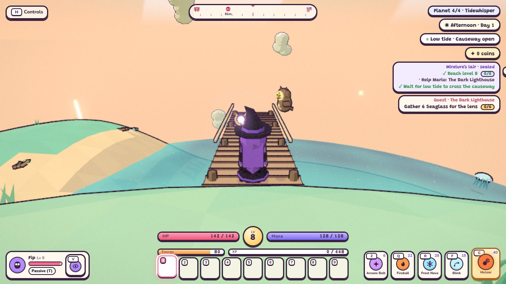
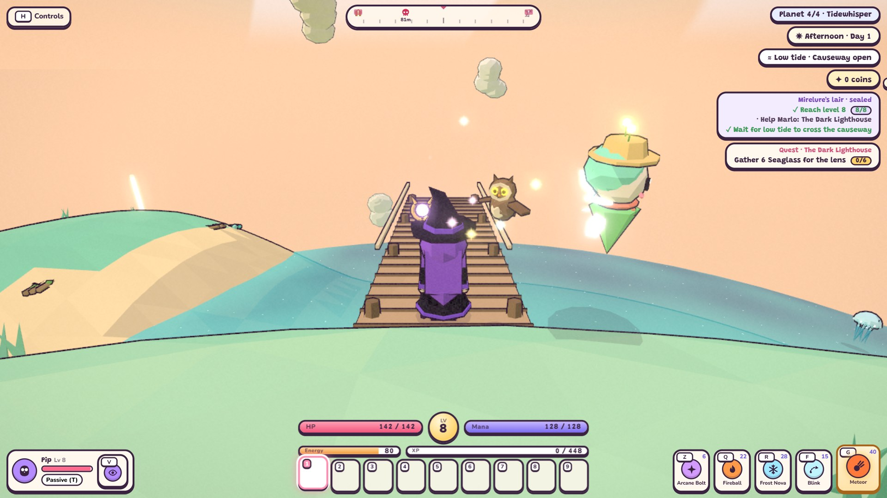

# Tidewhisper 27h: validation and hardware handoff

Status: **in progress / no-go**. Tidewhisper remains `released: false`. No release tag or `master` merge is authorized
by this checkpoint. On October 17 the owner selected the available Acer Nitro ANV15-51 / RTX 4050 Laptop GPU as
the default desktop validation machine. Other machines supply additional checks; Iris Xe access is no longer required.

Latest functional regression checkpoint: **243 units, all 53 simulations and all 17 affected Edge browser checks
pass**. See [step 2](#step-2-full-regression-checks), including the corrected pause-menu overflow and failed-attempt
history. Normal clean 18-case hardware acceptance, destination enablement and final tour/integration remain pending.

The test-only candidate harness substitutes the fourth catalog entry **before** importing Game, saves and achievements.
It borrows a released Act I fixture template and copies Tidewhisper content into that test object; the authored
Tidewhisper object and its `released: false` flag remain untouched. Restoration reinstates the original catalog identity.
It preserves the three original worlds and exercises real `tidewhisper` ids, scaling, portal travel and Continue.
It lives under tests/scripts and is never imported by the production entry point. Borrowing an Act I save slot is
insufficient release evidence: those earlier fixtures inherited missing configuration and could hide schema issues.

## Historical checkpoint evidence (2026-10-14–15)

- Fixed the two reviewed Mirelure defects: bubbles and the real lure now share a clock; diving cancels pending and
  active surface attacks. The simulation observes actual bubble emissions and checks both roll states and a bite.
- Added explicit empty forage (coastal resources/washups supply gathering) and eight common/three Lantern chests.
  The content gate now rejects missing forage arrays. The actual fourth-world campaign simulation passed on the original checkpoint; current synchronization results follow below.
- Browser campaign check passed portal UI travel, partial quest/node Continue after a full reload, return travel,
  720p/1080p low rendering, the level/quest/tide gate, campaign completion and one Tide Crown after reload, without
  page/shader errors. It stages prior boss wins and the final kill; it is not an uninterrupted human playthrough.
- Full checks: 211 unit tests and all 43 simulations passed, including terrain timing. The corrected coastal bot
  also passed affected reruns on both seeds. The dedicated Mirelure browser check passed on rerun after one earlier
  real-lure bolt assertion failure; that failure remains recorded in the work log.
- [Available-hardware diagnostic](../../tidewhisper-performance.json): Intel UHD/ANGLE/D3D11, 120 samples per scene at
  1280x720 low. Latest village/night/squall p95: 24.8/27.5/31.0 ms. Latest peaks: 448 calls and 185,864 triangles.
  The earlier run peaked at 451 calls and 186,584 triangles; timing variation is retained in the work log. These are **not**
  Iris Xe results and do not meet the 16.67 ms timing target. Fixed-scene ceilings are 550 calls/230,000 triangles.
- **Duel balance passes** ([report](../../tidewhisper-balance.json), `--check`: 0 of 18 checked rows outside target, both
  seeds, all heroes). The check follows `docs/wiki/game-design/balance.md`: each boss/mini-boss fight, and each hero's regular-roster
  median (2-6 s; measured 3.6-5.6 s). Single monsters are reported but not checked, as the contract allows armoured or
  evasive types to run longer: Shellback takes 4.5-7.7 s. Changes, with no targets loosened:
  - Old Ironclaw was luck-dependent: four early wedges let one ranger fight end in 41 s. It now falls for the wet
    sand once per shell (later charges skid to a stop until its next shell), and its base HP is 800 (was 1000).
    All fights: 156-174 s (target 90-180).
  - Mirelure's base HP is 3250 (was 3000), lifting the ranger from 171-176 s to 188-191 s. All fights: 188-289 s
    (target 180-300).
- The [initial strict balance baseline](../../tidewhisper-balance-baseline.json) is kept as history: 12/30 rows outside
  target, recorded before the melee-bot correction (the knight bot used 1.8 m reach and oscillated between shore and
  target, so its Jellybell times of 16.3/24.2 s were a bot defect, now 3.2/3.8 s).

| Candidate at 720p low | Candidate at 1080p low |
| --- | --- |
|  |  |

## Reproduce the candidate checks

Use the feature branch, Node matching the repository requirements, and a fresh browser profile (the helpers create
their own). These helpers own ports 8114/8115 and leave normal player browser saves alone.

```powershell
git fetch origin
git switch feat/todo-27h-campaign-release
git pull --ff-only
npm ci
npm install --no-save --no-package-lock puppeteer-core
npm test
npm run sim
node scripts/tidewhisper-campaign-smoke.mjs
node scripts/tidewhisper-balance.mjs --check
```

The balance reporter runs all three heroes on seeds 1 and 7 using the existing level-8, starting-equipment bots,
including approach/counter time and counted HP top-ups. Use `--output <path>` to preserve the historical report;
by default it saves `docs/tidewhisper-balance.json` and exits nonzero
with `--check` if any row misses its target. Investigate the bot's approach, reach and counter behavior alongside
damage tuning; a large timing spread is not solved by blindly scaling HP. Do not loosen the targets to publish.

## Run on the Acer reference machine

Run on AC with other heavy work closed, browser hardware acceleration enabled and the RTX 4050 active.
Default performance runs open visible fullscreen Edge. Hidden-browser (`--headless`) and GPU query
(`--gpu-timing`) profiles are separate diagnostics and cannot write release evidence.
The collector requests Chromium's high-performance GPU and verifies the actual WebGL renderer in all 18 rows.
It uses the existing desktop goal of 1920x1080 DPR1 High; earlier 720p Low reports remain separate diagnostics.
Commit candidate source changes first so the report identifies the exact code. `CHROME` can point to Chrome or Edge.

```powershell
$env:CHROME = 'C:/Program Files (x86)/Microsoft/Edge/Application/msedge.exe'
node scripts/tidewhisper-performance.mjs --release
```

The collector uses the actual fourth world, a 1280x720 viewport, Low preset, fixed village camera, daytime clear,
night clear and daytime squall. Each scene has 30 warmup frames and 120 measured frames, repeated for all three heroes on runtime seeds 1 and 7
(18 rows). World generation retains its authored seed. Light/tide phase is held fixed; real render time continues. It records the browser's
actual WebGL GPU string, candidate commit, working-tree state, p95 frame interval and peak full-composer counts.

The historical HD 4600 browser session paced frames at 60 Hz; `--disable-gpu-vsync --disable-frame-rate-limit`
did not change it there. Its empty-page Edge clock measured a p95 interval of 16.8 ms (median 16.7 ms), over a strict
16.67 ms. So the collector first measures that empty-page frame clock (240 frames) and records it as `frameClock`.
A scene passes if its p95 interval is no worse than max(16.67 ms, a valid empty-page p95). The clock only counts when
its median is a real 60 Hz (within 5% of 16.67 ms), so a 30 Hz display cannot loosen the budget. The content gate
applies the same rule (`frameLimitMs`). Per-frame CPU time of the game loop (`p95CpuMs`) and GPU time from timer
queries (`p95GpuMs`) are recorded as diagnostics only. They omit browser compositing and GC, and on the HD 4600
test machine they read up to 4 ms under the real interval, so they are never the pass number.

Default invocation (without `--release`) writes a diagnostic report only. `--release` writes
`docs/releases/tidewhisper.json` only if the candidate was clean, the actual renderer is the RTX 4050 Laptop GPU and all scenes meet
the frame/draw budgets. A JSON file copied from another device or synthetic test data is not certification.

## Finish 27h

1. Done: duel timing bands pass on both seeds for all heroes, and the `pacing` audit now covers Tidewhisper's XP
   route, coin budget (new Tide forge fees, 280 coins) and two-day material yields (see `docs/wiki/game-design/balance.md`).
2. Obtain passing Acer RTX 4050 evidence for the final candidate. Re-measure after material rendering changes.
3. Enable the destination only after its full gate passes. Update release-dependent tests, title/portal/journal
   expectations, player-facing tour and affected screenshots. Recheck old v1 saves and the real travel/Continue path.
4. Run full unit/simulation suites and required browser checks on the synchronized stage branch. Do not merge or
   delete it while any required check fails. Merge the completed stage into `feat/todo-27`, then the completed
   parent into `develop`, using the task workflow in [AGENTS.md](../../../AGENTS.md).
5. Record actual session cost, groundwork corrections and the final go/no-go. Do not approve Duskhollow or start
   optional otter work from this incomplete checkpoint. Request the separate release confirmation required by
   [AGENTS.md](../../../AGENTS.md) only when the tested `develop` release is concrete and ready for `master`.

Work started at 2026-10-14 23:57 (machine clock); step/total durations and final check results are recorded in
[the 27h work log](../../logs/2610142357%20todo-27h-release-validation.md). Time waiting for external hardware is not
misrepresented as completed implementation or hardware-validation time.

## Recorded session cost and groundwork corrections

The following are measured totals already present in the work logs. Older missing totals are not reconstructed
from commit dates. Consequently, the whole TODO 27 cost cannot be stated as a complete measured total.

| Work | Recorded elapsed cost | Evidence/limitation |
| --- | --- | --- |
| 27a–27e | Unrecorded totals | Their historical logs have no measured TOTAL row; preserve the original entries. |
| 27f | 0h 28m | [Old Ironclaw log](../../logs/2610141537%20todo-27f-old-ironclaw.md) |
| 27g | 0h 51m | [Mirelure log](../../logs/2610141608%20todo-27g-mirelure.md) |
| Earlier 27h implementation/validation sessions | 2h 08m | Initial gate 29m, frame-clock work 41m, duels 18m, pacing 10m, October 17 synchronization/diagnostic 30m. Separate session totals, excluding external waiting. |
| Earlier related 27h research/advice/review | 0h 07m | Cloud research 3m, independent-work advice 1m, branch review 3m. |
| Current Acer validation checkpoint | 1h 16m | [Clock-based session log](../../logs/2610171924%20todo-27h-acer-validation.md), started 2026-10-17 19:24:42; its TOTAL records elapsed time through this incomplete checkpoint. |
| Controlled comparison and UI cleanup (step 1) | 0h 22m | [Clock-based step 1 log](../../logs/2610172143%20todo-27h-matrix-comparison.md); completed diagnostic/targeted cleanup, full 27h acceptance pending. |
| Full regressions and pause-menu correction (step 2) | 0h 38m | [Clock-based step 2 log](../../logs/2610172211%20todo-27h-step-2-regression.md); 243 units, 53 sims and 17 final browser checks pass; hardware acceptance remains pending. |

Groundwork corrections found during 27h include explicit forage/chest configuration, actual fourth-world save ids,
Mirelure clue/dive consistency, and the two-sided frame-clock guard. The Acer continuation also corrects carried
adventure state in performance rows, aligns the expansion fixture with 1080p High, verifies every hero/seed/scene,
and distinguishes visible-browser acceptance from hidden/instrumented diagnostics. Actor batching preserves authored
geometry, animation and gameplay rules. These integration/validation costs belong in the next world's estimate;
Duskhollow approval and a separate optional-otter estimate remain later decisions.

## Synchronized functional checks (2026-10-17)

Continuation uses `feat/todo-27h-campaign-release`, from the new `feat/todo-27` parent at current `develop`.
The published `ae543c0` checkpoint is preserved in the continuation history. Its sole README conflict retained
the current concise overview; detailed handoff material now lives here in the wiki.

- 239 unit tests and all 52 simulations pass. The clock-calibration guard was corrected to enforce both sides
  of the previously approved +/-5% median band; the final unit suite and affected content-gate simulation pass.
- Campaign, Ironclaw and Mirelure Edge browser checks pass real input, 720p/1080p rendering, saved progress and
  zero page/shader errors. Campaign replay includes portal travel, partial quest/node Continue, revisit,
  quest/tide gate, full completion and one crown after a full reload.
- The final two campaign captures were opened and reviewed; incidental pet/save prompts were removed, clear
  weather and afternoon staged, subjects visible, and viewport bounds pass. Unrelated encounter recaptures restored.
- The authored Tidewhisper object remains unreleased during the candidate fixture. The fixture substitutes a
  test-owned catalog entry with existing released fixture metadata and restores the original object afterward.

This is a checkpoint. Target-device certification, destination enablement, release-dependent saves/title/portal/
journal checks and the final affected screenshot tour still belong to completion of 27h. See the
[session log](../../logs/2610171721%20todo-27h-sync-and-acer-diagnostic.md) for measured timings and outcomes.

### Fresh two-seed balance

[October 17 report](../../tidewhisper-balance-20261017.json): clean commit `2c42fce`, all 36 rows present,
all 18 required checks pass. Roster medians 3.58-5.55 s, Ironclaw 155.4-174.1 s, Mirelure 187.8-286.6 s.
See [the six-profile before/after table](../game-design/balance.md#tidewhisper-27h-synchronization-2026-10-17).

### Acer UHD measurement and go/no-go

[Fresh hardware report](../../tidewhisper-performance-acer-20261017.json), clean `1860d90`: all three heroes,
seeds 1/7, 18 cases / 2,160 frames, actual Intel UHD A7A8, 720p Low (896x503 buffer). 37.5-44.6 FPS,
p95 26.4-32.8 ms; none meets the applicable fixed 16.67 ms budget. Empty-page median/p95 6.1/6.4 ms is near 165 Hz,
so it cannot provide the 60 Hz calibration allowance. Eight cases exceed 550 calls (peak 636); triangles fit
230,000 (peak 191,804), with zero page/shader errors. See [conditions and scene table](performance.md#acer-intel-uhd-tidewhisper-diagnostic-2026-10-17).

The Iris Xe hardware dependency was superseded by the owner's Acer decision later on October 17. Profile and
reduce draw-call peaks, then collect clean Acer RTX 4050 evidence at 1080p High. Do not raise the count ceilings
or enable the destination from the earlier UHD report.
The synchronized functional/balance checks pass; performance acceptance and release-dependent work remain open.

### Acer RTX 4050 reference baseline

[Controlled reference baseline](../../tidewhisper-performance-acer-rtx4050-before-20261017.json): actual RTX 4050,
1920x1080 High, all heroes/seeds/scenes, 2160 measured frames. 31.55-42.42 FPS, p95 28.0-37.6 ms, peak 1072 calls;
all timing/count cases fail. Each row reloads a fresh adventure and seeds play before setup. Test-only source
overrides replay the original model files from `b3074d5`; their paths and full commit are recorded in the JSON.
This replaces the earlier carried-state exploratory baseline. It has `dirty: true` because the collector/profile
edits were not committed yet, so it is not release evidence. A per-root draw probe found ranger
119 draws, three visible Shellbacks at 72 each, and scenery only 25. Rigid actor pieces are the first batching target.

The original-mode report above used a hidden browser and GPU queries. The matched visible-browser comparison uses
`docs/tidewhisper-performance-acer-rtx4050-headed-before-20261017.json`, with every changed runtime rendering file
replayed from `b3074d5`, plus the corrected collector/reference configuration. GPU queries are off in both final
comparison runs. A visible-browser performance artifact is still required before enabling the destination.

The first clean optimized run (`8a8e432`) is preserved as
[the loaded-host report](../../tidewhisper-performance-acer-rtx4050-loaded-after-20261017.json).
All 18 render-count rows pass (peak 474 calls and 209111 triangles), but only one timing row passes;
p95 spans 16.1–27.5 ms. Available RAM was approximately 1 GB with active paging during the run.
The owner is closing unused apps for a repeat. This report failed acceptance and produced no release artifact.

[The repeat after closing apps](../../tidewhisper-performance-acer-rtx4050-freed-memory-20261017.json)
started clean at `2e669a9` with 4.44 GiB free before browser launch. All 18 count rows pass (peak 483 calls,
210141 triangles). Average rates improve to 63.14–110.45 FPS, but p95 spans 13.8–23.0 ms and only six timing
rows pass. No release artifact was written. The unchanged rendering source and profile show that freeing memory
helped; it did not resolve the acceptance shortfall. A subsequent knight/squall CPU profile still found matrix
updates among the largest JavaScript costs, motivating a regression-tested skip for hidden actor render branches.
An initial 900-frame knight/squall probe after that change measured 84.11 FPS, p95 18.4 ms and CPU p95 12.0 ms.
The preceding CPU-instrumented probe measured 77.56 FPS, p95 21.3 ms and CPU p95 15.9 ms; instrumentation and
actor motion differ, so this is diagnostic evidence rather than a controlled optimization comparison.
The hidden-branch change has all 243 unit tests and the performance simulation passing; a complete simulation rerun,
browser/tour review and a clean full-matrix repeat remain pending. Keep it on the stage branch with no release artifact.

### Step 1: controlled render comparison

[Raw ABBA comparison](../../tidewhisper-matrix-comparison-20261017.json): `actorCulling.js` from `2e669a9`
versus `253f859`, visible Edge on the RTX 4050, 1080p High, both seeds and every hero. Each profile ran before,
after, after, before: 120 setup updates, then a fixed simulation pose for 120 warmup and 360 sampled real render
intervals. Every row asserts identical setup positions and the exact call/triangle sequence against its control.
All 24 rows / 8640 samples pass those controls and have zero page/shader errors. Values pool 720 frames per variant/profile.

| Hero / seed | Before p95 interval | After p95 interval | Before render CPU p95 | After render CPU p95 |
| --- | ---: | ---: | ---: | ---: |
| Witch / 1 | 12.7 ms | 16.3 ms | 9.7 ms | 11.4 ms |
| Knight / 1 | 13.4 ms | 12.2 ms | 10.8 ms | 9.4 ms |
| Ranger / 1 | 11.7 ms | 10.7 ms | 9.0 ms | 8.0 ms |
| Witch / 7 | 11.6 ms | 10.6 ms | 8.7 ms | 7.8 ms |
| Knight / 7 | 11.8 ms | 12.1 ms | 9.1 ms | 9.3 ms |
| Ranger / 7 | 10.7 ms | 9.4 ms | 8.7 ms | 7.3 ms |

Four profiles improve, two worsen. Repeat ranges and host load vary, including a clear Witch/1 slowdown, so these
results do not support a universal timing gain or a claim that frame pacing is solved. Retain the tested matrix skip
for the next full regression/reference run, with that uncertainty explicit. Fixed poses isolate rendering and exclude
active gameplay cost: none of these rows certifies release performance.

Earlier dynamic diagnostic attempts failed exact pose/draw equivalence and were discarded. Resetting the startup
clock fixed initial poses, but wall-clock audio callbacks consume the play RNG and actor motion still varied.
Even a test-only independent audio stream did not make every draw sequence identical. The final fixed-pose
comparison leaves production audio intact. No diagnostic alters the authored release flag.

Separate live knight/squall traces ([before](../../tidewhisper-frame-trace-before-20261017.json),
[after](../../tidewhisper-frame-trace-after-20261017.json)) motivated a UI cleanup: prompt/chip HTML is cached,
and edge markers use the applied numeric UI scale rather than computed-style reads among DOM writes.
The new regression sim fails against the old implementation (21 prompt replacements instead of one) and passes
with the fix. Timeline HTML parses fall from 1022 to zero. Layout counts remain approximately one per frame
(480 before, 483 after), and the instrumented after trace is slower overall (p95 18.4 versus 14.5 ms).
These live traces have differing motion/load and tracing overhead; no FPS gain is attributed to the UI cleanup.

Targeted UI simulation and the new Edge smoke cover unchanged DOM, live coins/key changes, hide/return, HUD scale,
real rebound keyboard interaction and bounds at 720p/1080p, with zero page/shader errors. The remaining sequence is:
full regressions; clean ordinary 18-case acceptance; destination enablement and production saves/travel/completion;
then tour/docs and stage/parent integration. Tidewhisper stays unreleased until the complete gate passes.

### Step 2: full regression checks

[Structured results](../../tidewhisper-step-2-regressions-20261017.json) retain every browser attempt, timestamps,
durations, output, script hashes and style provenance. The candidate game JavaScript is unchanged from `3be9e00`.

- `npm test`: 243 pass, zero failures/skips. Repeated after the check/layout corrections: 243 pass (7.1 seconds).
- `npm run sim`: all 53 pass, seed 1; 22:12:38-22:24:27 local clock. The terrain timing check ran without a browser,
  performance collector or screenshot job competing. Includes the new HUD check, all hero kits, rendering pivots,
  encounters/duels, saves/travel, coastal systems and the Tidewhisper campaign.
- All 17 browser regressions pass on their latest attempt: HUD performance; coastal enemies, wildlife, village and
  resources; Witch, Warrior and Ranger talents; Ironclaw; Mirelure; Tidewhisper campaign; portals; saves; sets;
  photo; lighting; tutorial. They run sequentially in Edge. Coverage includes real input, 720p/1080p bounds,
  reward/Continue behavior and zero page/shader errors. Software rendering costs are not hardware FPS evidence.

The tutorial script initially failed the main pause-page fit assertion at 720p. A diagnostic capture showed
`scrollHeight: 614`, `clientHeight: 611`; waiting for the opening animation did not fix it. The new main-page-only
viewport height allowance leaves at least 16 px above/below and preserves all actions. The existing strict fit
assertion stays intact. Tutorial and save reruns pass, including content fit at both resolutions; both corrected
save-menu captures were opened and reviewed. Three failed tutorial attempts remain in the report (22 total browser
attempts, 17 distinct scripts). Final successful runs use the current script versions.

Older save/portal/tutorial checks now catch shader console errors and close browsers with a bounded timeout.
Save defaults to Edge and checks 1080p as well as 720p. Simulation source did not change; the only product correction
in this session is scoped CSS, checked by the affected browser reruns. Incidental tracked captures were restored;
the final screenshot tour remains step 5.

Step 2 is complete. Remaining: **3**, clean ordinary 18-case 1080p High reference acceptance; **4**, enable the
destination only after acceptance and check production saves/travel/completion; **5**, final tour/docs and tested
stage/parent integration. No destination flag, merge or public release was performed here.
