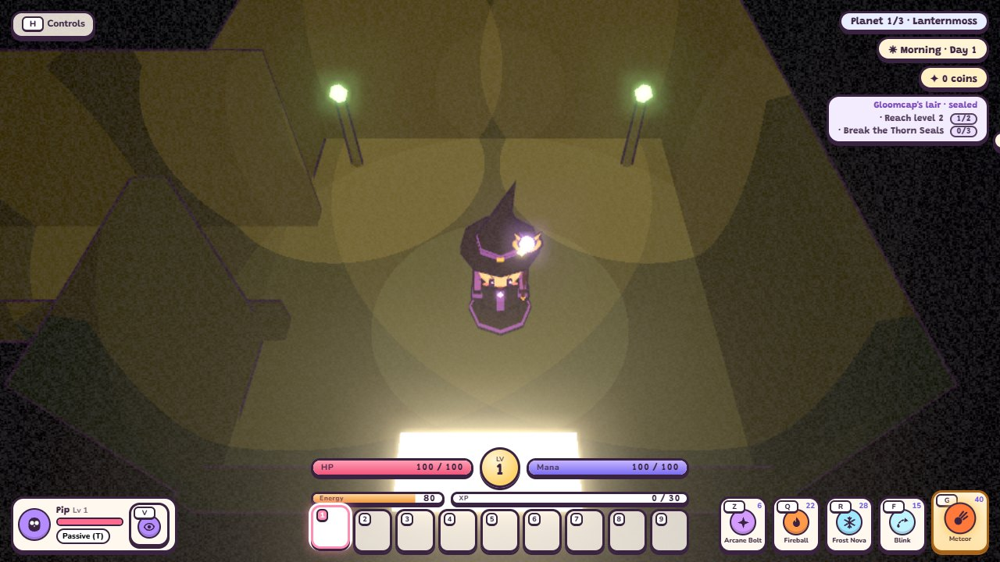

# Caves (TODO 29)

Each main planet will have a cave entered from the surface: a few rooms with monsters, chests and ore found nowhere
else, ending in a guardian (the plan is in [TODO.md](../../../TODO.md), stages 29b-29g). **Status: layout, traversal
and combat context (29b/29c) are built; the caves are unreleased.** No cave mouth appears until 29f. Encounters use
test fixtures; normal cave rosters, rewards, saved room progress, puzzles and guardians are later stages.

## Layout (29b)

A cave is built from a kit of rooms (`ROOM_KIT` in `src/config/dungeons.js`): `entrance` (always first), `hall`,
`chamber` and `end` (the room deepest from the entrance). Rooms sit on a grid, 16 m apart, joined by 2.6 m corridors.
A seeded walk from the entrance adds one room at a time next to an existing one, so the rooms form a tree: every room
is reachable, there are no loops, and the entrance keeps its south side free for the mouth.

The seed is the planet's own, so a planet always builds the same cave. Room ids are `${cave.id}:r${n}`, numbered in
generation order (for example `lanternmoss-cave:r0` is always Mossroot Hollow's entrance). Later stages save progress
against these ids.

| Planet | Cave | Rooms |
| --- | --- | --- |
| Lanternmoss | Mossroot Hollow | 5-7 |
| Emberfall | Cinder Warren | 6-8 |
| Frostveil | Rimeglass Grotto | 6-8 |

Each cave has its own floor, wall and lantern colours. The pure rules (layout, walkable floor, which room a point is
in) are `src/world/caveLayout.js`; the 3D rooms are `src/world/caves.js`.

## Inside a cave

- **The surface mouth.** Each planet works out its mouth spot 34-60 m from the village square, clear of the farm,
  crafting corner, gate, bounty board and resource nodes. It is placed after everything else, so no saved position
  moves for it. Only a released cave shows its rocky arch and the "Enter ..." prompt.
- **Walking.** The rooms are built far below the planet. The hero uses the normal movement, sprint and jump controls,
  under the same following camera as house interiors, with walls cut low on the camera's side. Walls stop the hero;
  doorways are the corridor's width.
- **The dark.** A cave is fully dark ([local light](../technical/lighting.md), darkness 1). The hero carries a light
  and each room's lanterns light the rest; the minimum ambient keeps the outlines readable.
- **Fighting (29c).** All three kits work, including Blink, Shoulder Charge, Evasive Leap and aimed ultimates.
  Clicks pick the room floor; lock-on uses the enemy's position; warnings lie on that floor. Walls stop movement,
  fast shots, lock-on and area damage. Leap Slam needs a reachable landing. Blink and knockback use swept collisions.
  Existing cooldowns, costs, damage and talent kits are unchanged.
- **Companions.** Walking and flying pets come inside, route through doors and keep their commands, attacks,
  health and abilities. Stay records a room position. Fetch has no cave items/chests yet (29d); a failed attempt
  spends no cooldown. Houses remain peaceful and pets still wait outside them.
- **Leaving.** Step back onto the bright patch at the mouth, or press **E** there ("Leave the cave"). You come out at
  the surface mouth, facing away from it.
- **Treasure (29d).** Rooms other than the entrance hold chests and gloomquartz veins; see below.
- **Never stranded.** Fainting inside takes the hero out at once; the usual respawn brings them home to the village.
  Travelling to another world or starting a new adventure leaves the cave too. A save made inside records the cave and
  the room position, so Continue goes back in where you stood (29d); a save made after fainting starts on the surface.

## Combat frame and surface isolation (29c)

`physics/RoomSpace.js` supplies fixed up, floor points, height, swept wall/body checks and room-graph paths.
`Walker.step` uses it for cave actors. `combat/space.js` separates position from up: surface combat points are planet
directions; room combat points are world floor positions. Targeting, ground aiming, projectiles, areas, decals,
shadows and pets share those queries. There are no separate cave hero moves.

Entry cancels aim and clears transient projectiles/hazards. Surface enemies and pickups are kept, hidden and frozen;
surface boss, village safety, lair and challenge systems do not drive cave combat. Surface weather particles stay
outside. Leaving restores the same surface
objects and health, returns hero/pet to the planet, and removes cave attacks, lights and actors. A lethal hit can
leave during a projectile, melee or hazard callback safely. Travel/new-adventure resets restore surface ownership
before save hooks and disposal. Saves inside record the cave, the room position, pickups and the pet stay point.

Representative encounters cover goblin melee, wisp shots, slime hopping/contact and ogre slams, plus both pet bodies.
Bespoke planet-boss and coastal behavior kits are not certified for room use; later rosters/guardian stages must
audit their chosen encounters before rollout.

## Rewards and persistence (29d)

What a cave holds is decided by `caveFixtures` (`src/world/caveLayout.js`) from each **room's own id**, so a room
always keeps the same chest and the same veins however the rest of the cave changes. `src/gameplay/CaveRewards.js`
builds them in the room frame, hands out their loot and keeps the progress.

- **The entrance stays empty.** It is the safe room: no chest, no vein, no monster spawn.
- **Chests.** A `chamber` room holds the cave's ordinary chest kind; the end room holds its better one. Loot is
  rolled by the usual table (`src/gameplay/loot.js`) and goes **straight into the bag**, with coins to the wallet:
  underground there is no surface to pop items onto, so nothing can be left behind on a floor about to be disposed.
- **Gloomquartz veins.** `CAVE_VEINS` are mining nodes that no planet surface ever places, so **Gloomquartz** can only
  be dug out of a cave. Mining follows the surface rules (a pickaxe, a few swings, a better pick needs fewer); walking
  away cancels the job. Gloomquartz brews the Restorative Elixir in place of amethyst (`gloomElixir`).
- **Placement.** Fixtures hug the walls, inset by `CAVE.reward.veinInset`, and keep clear of every doorway, so nothing
  a cave gives out can block the way through. Chests stand at the room's centre.
- **Room progress.** A room registers as **visited** the moment the hero stands in it, and as **cleared** once its
  monsters have fallen (`CAVE.reward.clearedBy`), so a revisit does not repopulate it.
- **Never twice.** `opened`, `mined`, `cleared` and `visited` are kept per cave and saved with the **planet**
  (`caves` in `src/core/save.js`). A chest or vein already in that record is rebuilt already claimed, so leaving,
  fainting, Continue or the cave being regenerated can never pay it out again.
- **Each cave is its own.** Every id begins with the cave's id, and a planet's snapshot is cleaned down to that one
  cave, so portal travel never carries one planet's cave progress into another's.
- **Older saves.** A save written before 29d simply has no cave rows and no cave pose: it starts on the surface with
  every cave untouched. A pose naming a cave this planet does not have is ignored, and the hero stands at the mouth.

Not yet done: the puzzles, locked door and end guardian (29e), and the per-world ore, rosters and guardian loot that
release the caves (29f, 29g). Every cave is still unreleased, so none of this is reachable in normal play; the checks
below reach it through `Dungeons.enter` and test-only fixtures.

## Verification

- `node --test tests/caveLayout.test.mjs`: the same seed gives the same rooms, ids, kinds and doors; every room is
  reachable and doors pair up; room counts stay in range and rooms never overlap; a walker can cross every link and
  stand at the mouth, and walls stop it (all three caves, ten seeds).
- `node tests/sim/caves.sim.mjs`: mouth spots on all three worlds, none shown while unreleased; the same seeded cave
  in the game; real movement keys through every room; a wall holds; leaving by the mouth and by E; Continue after a
  save inside starts at the mouth; fainting inside and travelling leave cleanly.
- `node scripts/caves-smoke.mjs` (Edge, port 8124): real keys from room to room under the following camera, readable
  dark at 720p and 1080p, real E at the mouth leaves, zero page or shader errors. It retakes the shot above.
- `node --test tests/roomSpace.test.mjs`: distinct points under the same up, flat height/gravity, wall/body sweeps,
  escaping an overlapping landing, and routes through doors.
- `node tests/sim/caveCombat.sim.mjs`: all hero kits, ultimates and both pet bodies on seeds 1/7; real enemy attacks,
  wall occlusion, area distances, surface restoration, Continue, lethal callbacks, travel and house peace.
- `node scripts/cave-combat-smoke.mjs` (Edge, port 8125): all heroes at 720p/1080p; real mouse/key casts and ground
  markers, movement after an ultimate, walls, following camera, health bars, no overflow, E exit and house peace.
  Zero page/shader errors; retakes the combat shot above. No release flag changes in any check.
- `node --test tests/caveRewards.test.mjs`: fixtures are deterministic and owned by their room, the entrance stays
  empty and the end room keeps the better chest, nothing stands in a wall or reaches into a doorway, cave ore is on no
  surface node and is worth carrying home, and the `caves` and player cleaners drop other caves' rows and default an
  older save to the surface (all three caves, ten seeds).
- `node tests/sim/caveRewards.sim.mjs`: the cave is furnished from its layout; a real prompt mines a vein for
  gloomquartz and opens a chest into the bag; a room registers as visited and as cleared when its monster falls;
  leaving, re-entering, Continue underground and fainting all keep the progress without a second payout; and each
  planet's snapshot holds only its own cave.
- `node scripts/cave-rewards-smoke.mjs` (Edge, port 8126): real movement keys walk up to a vein and a chest until the
  game offers them, real **E** mines and opens, the bag and wallet change once, leaving and entering rebuilds them
  already claimed, and leaving disposes every fixture while keeping the record. 720p and 1080p, nothing overflowing,
  zero page/shader errors; it retakes the rewards shot above.
