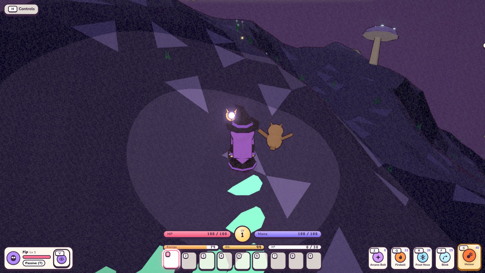
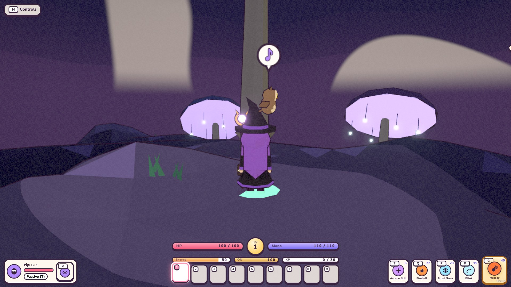
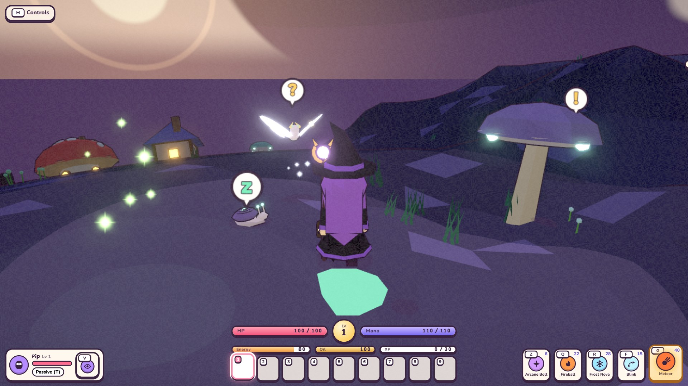
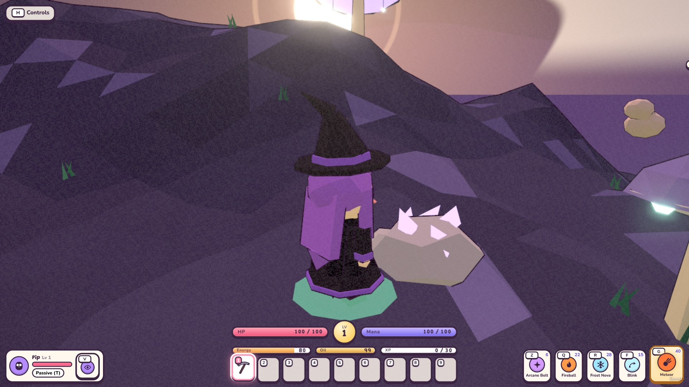
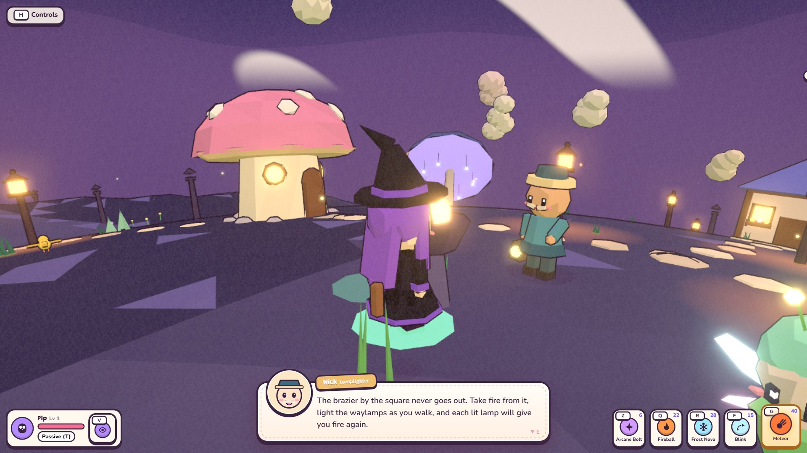
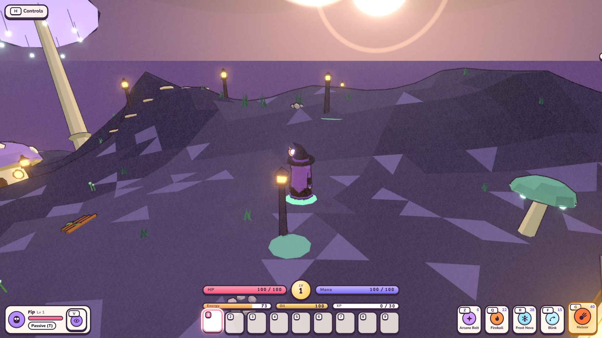
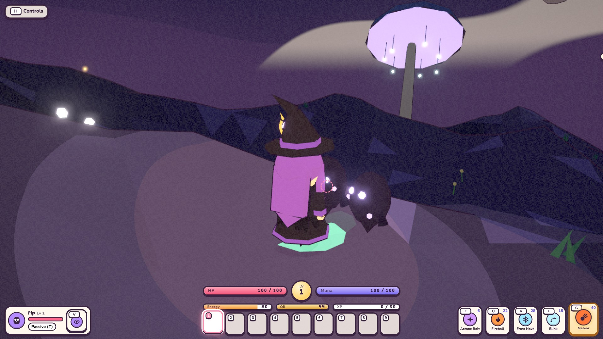
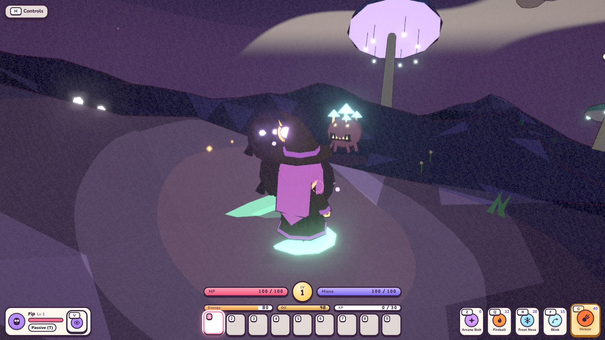

# Duskhollow: twilight terrain and the lantern

## In brief (stages 30a-30e, unreleased)

Duskhollow is the fifth world: deep valleys under a canopy of giant lumen caps, where your lantern decides what you
can see. Stage 30a builds its terrain, its endless dusk, the belt lantern with its Oil bar, and the glowmoss that
lights up in your footprints. Stage 30b fills it in: the canopy itself and the plants under it, glow snails, lantern
bats, crickets and pale blind fish, firefly swarms you catch for lantern oil, and the Moonmoth, whose charm widens
your light. Stage 30c gives it an economy and a sky of its own: lumen ore, ingots and dust, spider silk, the
guarded moonstone vein, lantern oil, shade mushrooms, the craftable Dusk set, spore drift and deep dark, the
dripping caps that water the farm where no rain falls, and a music box theme. Stage 30d gives it people and a
purpose: Wick the lamplighter in a stalk you can walk into, the travellers' lines, the village brazier, the Old
Road's waylamps and the three moonwells his quest asks you to relight, and the gate that keeps Umbra asleep. Stage
30e sends the first monsters after you: shadelings, which only your light can touch, and mosslurks, which look
exactly like the glowcaps they are sitting among. The rest of the planned checklist - gloomweavers and snuffers
(30f), Grandmother Gloomweaver (30g), Umbra herself (30h) and campaign release (30i) - is **not built yet**.

Duskhollow stays `released: false`: it cannot be selected, generated or travelled to in normal play. The checks run
it through a development fixture (`tests/sim/lib/duskhollowFixture.mjs`) that copies this world's content into the
first released world's save and travel slot. That fixture is test-only, is never imported by the game's entry point,
and does not enable anything for players.

## Shape and look (30a)

`src/config/planets/duskhollow.js` seeds deep valleys from hills and ridged noise (`terrain.ridges`), so the world is
a set of hollows between high stalk ridges rather than rolling meadows — the checks require more than 12 m between
its lowest and highest ground. The palette is violet rock and dark teal glowmoss under an indigo sky, with the
world's own fog. One lake is carved as usual, and the village, stone circle, farm and outer houses keep their level
ground exactly as on every other world.

The canopy is authored data: `canopy` lists its height and the gaps of starlight, as an angle, a distance and a
radius around the village. Stage 30b grows the caps themselves to match it (below).

## The endless dusk (30a)

The day clock still turns here. It runs as brighter and dimmer dusk instead of day and night: `duskAt()` in
`src/world/mechanics/lantern.js` is brightest at midday and deepest at midnight, and never reaches daylight or full
dark. How much of that dusk reaches the ground depends on the canopy above it:

| Where you stand | Canopy cover | What it looks like |
| --- | --- | --- |
| Under the closed canopy | `LANTERN.canopy.cover` (1) | The full dusk: the deep hollow, where the lantern matters |
| In a gap of starlight | `gapCover` (0.35) | Noticeably brighter; the gaps are landmarks |
| In the village | `villageCover` (0.12) | The world's safe light, bright enough to read at a glance |
| Inside a house | none | Darkness is 0; interiors keep their own light |

Cover times dusk is the darkness handed to the shared [local light](../technical/lighting.md), which dims the sun,
sky and fog but keeps its minimum ambient and the ink outlines. The browser check measures this: on the lowest
quality preset the deepest hollow at midnight still reads at about 90/255 mean ground luminance, and the village gap
at about 205/255. A dark world, never a black screen. A cave keeps its own darkness while you are inside one.

## The belt lantern and the Oil bar (30a)

The lantern hangs from the hero's belt and becomes the light they carry. Its fuel is **Oil**, shown in its own bar
beside Energy; the bar only appears on a world that has a lantern, and the status chip names the light you are
standing in.

- **It burns only while you actually play this world outdoors.** Not indoors, not in a cave, not in a menu or while
  paused, and never over skipped or away time — sleeping through a night cannot empty the tank. A full tank is about
  one adventure day of light.
- **An empty lantern is safe.** It shrinks from a 7.5 m light to a small 2.8 m ember; it never goes out, never
  damages the hero and costs nothing else. Running dry makes the world harder to read, not unfair.
- **Refills** go through `refill(amount)`. The things that will pour oil in — glowcaps, firefly jars and lumen oil —
  arrive with 30b and 30c; `burn(amount)` is there for the Snuffers' theft in 30f.
- **Oil is saved per planet** in the mechanic snapshot (`{ oil }`), so it survives Continue and travelling away and
  back. See [the planet mechanic lifecycle](../technical/planet-mechanics.md).

## Glowmoss footprints (30a)

The carpet of moss lights up where the hero walks: one glowing disc every 1.15 m, fading out over 4.5 s. The whole
trail is a single additive instanced draw call with a hard cap of 24 live prints, and the scenery-density setting
scales that down (the lowest preset draws 8, and 0 % draws none). It is cosmetic only: prints are never printed
while airborne, swimming or indoors, and they change nothing about movement, combat or loot.

## Flora: the canopy and what grows under it (30b)

`src/world/duskFlora.js` plants Duskhollow, and one rule ties it to the light: **a giant lumen cap only grows where
the dusk is at full strength**, so the canopy is solid over the deep hollows and genuinely open over every gap of
starlight and over the village. What you see overhead always matches how dark it is underneath.

| Plant | Where | Notes |
| --- | --- | --- |
| **Lumen cap** | Only under the closed canopy | A pale stalk about 23 m tall under a cap 8 m across, so the canopy hangs about 25 m up, its gills lit from below, with lantern vines hanging from the rim. Not wood: an axe cannot chop it |
| **Glowcap** | Anywhere, gaps included | The small caps you walk under, lit around the rim |
| **Ghost fern** | Anywhere | Pale fronds in clumps |
| **Pale moonflower** | Anywhere | A low stem under a glowing head |

Counts are authored in `flora.canopy` and each one is capped in code, so no quality setting or seed can flood the
world. Glowmoss is the trail you light as you walk (30a) rather than a planted thing.

## Wildlife (30b)

| Animal | What it does |
| --- | --- |
| **Glow snail** | Creeps along with its shell lit from inside; pulls in and sits still when you come close |
| **Lantern bat** | Hangs in the air under the caps with a lantern on its belly, and flutters off if you walk under it |
| **Dusk cricket** | Chirps and hops away near the ground; you hear it before you see it |
| **Pale blind fish** | Colourless shoals in the glowing pools, with the usual pond behaviour |
| **Moonmoth** (rare) | Wide pale wings; shy like every rare creature, and it leaves the **Moonmoth Wing** |

The Moonmoth Wing is worn in a trinket slot. While it is worn, a lit lantern reaches `LANTERN.charm.radius` times
further (7.5 m becomes 10.5 m); an empty lantern's safe ember is never changed by it. It is a gift only: it is kept
out of random chest loot (`props.giftOnly`), so an unreleased world's charm cannot turn up in a released world.

## Firefly swarms and jars (30b)

Swarms of fireflies drift over the hollows. Each one is a soft light and a trickle of particles rather than a crowd
of bodies, so a whole world of them costs no extra draw calls and follows the particle-density setting. Walk up to
one and press `E` to catch it: you get a **Firefly Jar**, and that swarm goes dark for `FIREFLIES.away` seconds
before another settles somewhere else. Using a jar pours 25 oil into the lantern.

How long each caught swarm still has to wait is saved per planet, so Continue cannot relight them and reloading
cannot farm jars. See [adventure saves](../technical/save-format.md). Glowcap and lumen-oil refills arrive with 30c.

## Resources and the lumen chain (30c)

| Found | Where | Becomes |
| --- | --- | --- |
| **Lumen ore** | Lumen veins, with an iron pickaxe | **Lumen ingots** at the forge |
| **Lumen dust** | Shaken loose from the same veins; the world's own material, so it fills its chests | Lumen oil, and every Dusk piece |
| **Glowcap** | Glowcap patches, by hand | Lumen oil at the brewing stand - or tipped straight into the lantern for 10 oil |
| **Moonstone** | One guarded vein, placed behind the mini boss like every rare vein | The Dusk Lantern trinket |
| **Spider silk** | Cut from gloomweaver webs in 30f; until then from chests | The lining of every Dusk piece |

**Lumen oil** is the full flask: it fills a belt lantern to the brim. With firefly jars (30b) and glowcaps, the
world now has three ways to keep the light on, which is what the lantern was always waiting for.

**The Dusk set** (`duskHood`, `duskMantle`, `duskBoots`, `duskLantern`) is forged from lumen ingots, silk and dust,
and reserved by this world's coin budget the way Tidewhisper reserves the Tide set. Its bonuses are about the light
rather than about fighting:

| Pieces | Bonus |
| --- | --- |
| 2 | Your lantern burns 40% slower |
| 3 | Your lantern burns 60% slower and reaches 15% further |

Both reach the lantern through the hero's ordinary set effects (`lanternOil`, `lanternRadius`), so they follow
equipping, unequipping and loading like every other stat.

## Weather, the dripping caps and the shade crop (30c)

No rain ever falls under the canopy. Duskhollow's sky draws from clear, fog, breezy, **spore drift** (glowing spores
drifting through the hollows) and **deep dark**. The weather itself changes no rules: deep dark only states a number
(`deepDark`, blended 0..1 like any other weather value), and this world's mechanic decides what it means - it
thickens the dusk by `LANTERN.dusk.deepDark` of the light that is left and presses a lit lantern in by
`LANTERN.light.deepDarkShrink`. It still never reaches full dark, and it still costs no health.

The same split holds for the farm. Since no rain falls, the **dripping caps** water every planted plot early in the
day (`LANTERN.drip`): the farm asks the live mechanic for `watersFarm`, rather than any weather kind quietly
standing in for rain. **Shade mushrooms** grow from shade spores and only take where the mechanic says the world
lies in shade, which today is Duskhollow alone; anywhere else the plot refuses them.

Its music is a **music box over low strings** (`musicBox` in `src/config/music.js`), made in code like every other
theme.

## Wick and the Old Road (30d)

**Wick the lamplighter** lives in a mushroom stalk on the village square. He keeps the keeper's look and swinging
lantern that Tidewhisper's Marlo wears, walks the square in the morning and evening, and sleeps at home. He is the
one who tells you what Umbra does with light, and he asks for the quest the world is built around.

**The Old Road** leaves the village in one branch for each of the first three authored gaps of starlight, so every
**moonwell** stands under open sky. Waylamps line each branch at a fixed spacing (`OLD_ROAD.branches`), and the
**village brazier** burns in the village gap, where the light is already safe.

| What | Where | What it does |
| --- | --- | --- |
| **The village brazier** | The village gap | Never goes out. Press `E` to take the village flame |
| **A waylamp** | Every `spacing` metres along a branch | Dark until you light it. Once lit it stays lit for the rest of the adventure - and gives you fire again |
| **A moonwell** | In each gap of starlight | One of Wick's three. Lighting all three finishes his quest and is half of Umbra's gate |

**Carrying the flame.** A fresh flame lasts `OLD_ROAD.flame.seconds` of play, and it burns by exactly the same rule
as the lantern on your belt: never indoors, never in a cave or a menu, never while paused, and never over skipped or
away time. Lighting a waylamp is a relay - it fills the carried flame right back up - so the road lights itself once
you have started. **Running dry costs nothing but the walk back**: the flame simply goes out, the lamps you already
lit stay lit, and the last of them is where you take fire again.

What is alight, and how long the carried flame has left, are rules of this world's mechanic, saved per planet beside
the Oil bar, so Continue and portal travel find the road exactly as you left it. A lit lamp head glows on its own;
only the brazier, the moonwells and the nearest `OLD_ROAD.lamp.sources` waylamps hold a
[shared local light](../technical/lighting.md), so a road relit end to end costs no more than a road with two lamps
lit.

**Inside the stalks.** Two houses can be entered: Wick's own and a traveller's. They are ordinary round rooms with a
stalk's inside - lit gills overhead instead of a flat ceiling, a lantern vine, and the lamplighter's oil jars. Wick's
bookshelf carries the lamplighter's round and the night Umbra came.

**Umbra's gate.** `boss.summon` is `{ level: 11, quest: 'oldRoad' }`: she sleeps in her lair until the hero is
level 11 **and** the three moonwells burn. The sealed lair, its status chip and the bestiary all say so through the
ordinary [boss gate](monsters-and-bosses.md). Her fight, her trophy and her arena arrive with 30h.

## Shadelings and mosslurks (30e)

Duskhollow's first two monsters both take their rules from the thing the whole world is about.

### The shadeling

Out in the dusk a shadeling is **only a shadow**: a dark stain sliding over the ground after you, with two pale eyes
in it. Nothing can hit it there - and, by exactly the same rule, **it cannot hit you**. It may follow, but it never
even begins a blow. An unreadable monster, in other words, can never land one.

Where the ground is lit it **stands up solid**: a hunched smoke-coloured figure with three wisps turning around its
head, which fights, and which you can fight. What counts as lit is everything that makes light here, through
`OldRoad.litAt()`: the village gap, the lantern on your belt (full, or down to its safe ember), the brazier, and
every waylamp and moonwell relit on [the Old Road](#wick-and-the-old-road-30d). **A road you lit is a road you can
fight on**, which is the quiet reward for Wick's quest.

A **burst** of light drives it off - light that was not there a moment ago, never light you merely walked closer to:
a waylamp or moonwell catching, or an empty lantern refilled beside it. So does fire: the witch's Fireball and
Meteor carry it, and so does an Ember-set burn. Every hero has the first counter, since every hero carries a
lantern here.

### The mosslurk

A cluster of glowcaps with teeth. While it is disguised it is scenery: nothing can hit it, it has no health bar, it
does not move, and it offers the prompt a real glowcap patch offers - **"Pick the glowcap patch"**. Reaching for it
is the ambush. So is walking right over it.

Springing is never a free hit. It rears up with a warning circle on the ground for its whole wind-up before the
first bite, so a hero who reached for the wrong caps can still step out of it, and it is slow enough afterwards to
back away from. Nothing about a mimic is saved: they are rebuilt with the planet's roster, always disguised, so a
save can neither leave one sprung nor remember which patch bit you.

| | Shadeling | Mosslurk |
| --- | --- | --- |
| Where | Camps of three through the hollows | Beside the real glowcaps (`near: 'glowcaps'`) |
| Untouchable while | It is standing in the dark | It is still disguised |
| Counter | Light: carry it, or relight the road. Fire drives it off | Watch the warning circle; count the caps - a real patch does not blink |
| Leaves | Often lumen dust | Often the glowcaps it was wearing |

## What is checked

| Check | What it proves |
| --- | --- |
| `npm test` (`tests/lantern.test.mjs`) | The dusk curve, canopy cover, deep seeded valleys, the cleaned saved oil field, and that burning, refilling, indoors and skipped time behave — all without a browser, a scene or settings |
| `npm run sim -- duskhollow` | The real world generates with its mechanic; dusk follows the clock and the canopy; the Oil bar and chip render; pause and a night of sleep burn nothing; an empty lantern costs no health; the trail stays bounded; oil survives save, Continue and real portal travel |
| `node scripts/duskhollow-smoke.mjs` | In a real browser on the lowest preset: readable dusk, a brighter village gap, real WASD walking lighting the trail and burning oil, the safe ember, 720p/1080p with nothing overflowing, and zero page and shader errors |
| `npm test` (`tests/duskWildlife.test.mjs`) | The canopy rule, that every authored plant and animal exists and is bounded, the jar's oil effect, and that the charm widens a lit lantern but never the ember |
| `npm run sim -- duskWildlife` | Placement and the no-cap-over-a-gap rule, each animal's reaction, catching a swarm through the real interaction, its saved timer surviving Continue, the Moonmoth's one charm per adventure, and the scenery, particle and light budgets |
| `node scripts/dusk-wildlife-smoke.mjs` | In a real browser: the canopy and animals render, real `E` catches a swarm, really using the jar pours oil, the charm widens the carried light, 720p/1080p, zero errors |
| `npm test` (`tests/duskEconomy.test.mjs`) | Every node, forage and material is real; the lumen chain and Dusk recipes; the set reaching the lantern; deep dark as a number turned into a rule; the drip window and the shade crop |
| `npm run sim -- duskEconomy` | The veins and patches are placed with the music box playing, the chain smelts and brews, the worn set slows the burn, deep dark thickens the dusk and shrinks the light, the caps water the farm with no rain, and shade spores refuse a sunlit world |
| `node scripts/dusk-economy-smoke.mjs` | In a real browser: real `E` mines a lumen vein with the iron pickaxe, the Craft tab lists the chain and the set, a glowcap pours oil, deep dark visibly darkens the hollow while the lit ground stays readable, and real `E` plants shade spores |
| `npm test` (`tests/oldRoad.test.mjs`) | The saved lit lamps and flame, cleaned and bounded; taking fire, the relay, a flame that runs dry, the three moonwells counted once; Wick, his stalk and the level-11 gate |
| `npm run sim -- oldRoad` | The road is built where the fiction says, Wick offers and tracks his quest, the flame is carried and runs dry through the real interactions, Continue and portal travel keep the road lit, the three wells finish the quest, and level 11 unseals the lair |
| `node scripts/old-road-smoke.mjs` | In a real browser: real `E` takes the village flame and lights a waylamp, a lit lamp hands out fire again, running dry costs no health, the village gap is still safe light, and a relit lamp's light reaches the shader |
| `npm test` (`tests/duskMonsters.test.mjs`) | The authored stats, roster placement, pages and drops, and the arithmetic that keeps every counter reachable: a lantern, an ember, a waylamp and a moonwell each light brightly enough to bind a shade |
| `npm run sim -- duskMonsters` | A shadow that cannot be hit and cannot hit back, the lantern and a relit waylamp standing one up solid, a lamp catching and a hit of fire driving it off, an empty lantern staying safe, the gather prompt and both ways of springing a mimic, and Continue/travel leaving none sprung |
| `node scripts/dusk-monsters-smoke.mjs` | In a real browser: both kinds render, a shadeling really cannot be hit in the dark and really can in the light, a waylamp coming on really drives it off, and real `E` on a mosslurk's caps springs it with its warning circle first |

## Not built yet

Gloomweavers, Snuffers, Grandmother Gloomweaver, Umbra herself and the campaign release. The roster holds only two
of its four regular monsters and no mini boss, so Duskhollow still fails the content gate by design, and nothing yet
answers the gate Wick's quest opens. Spider silk has no source in the world until the gloomweavers' webs arrive in
30f, and the moonstone vein's guard arrives with Grandmother Gloomweaver in 30g, so for now it is simply mineable.
