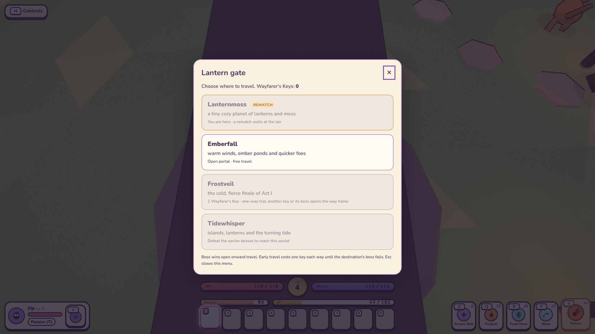

# Monsters and bosses

| Monster | AI | Planets | How it fights |
|---|---|---|---|
| Goblin | melee | 1, 2, 3 | fast hit-and-run, flees when hurt |
| Ogre | melee | 1, 3 | slow, telegraphed ground slam you can jump over |
| Wisp | ranged | 1, 2, 3 | keeps its distance, fires slow homing orbs |
| Slime | hopper | 1, 2 | bounces at you, splits into slimelings |
| Puffcap | bomber | 2, 3 | rushes in, swells on a fuse, bursts. Stagger it to defuse, kill it to prevent the blast |
| Ramhorn | charger | 2, 3 | marks a lane, then charges in a line. Sidestep it; if it hits scenery it's dazed and takes +50% damage |
| Thornmole | burrower | 3 | tunnels (untargetable) and erupts under you after a tremor, then stays exposed briefly |
| Hexlantern | support | 3 | follows fighting monsters, heals them and shields them (−50% damage). Kill it first |
| **Gloomcap** (boss) | boss: gloomcap | 1 | the introduction: slam, lane charge, homing volley, shockwave ring (jump it), summons; three phases |
| **Pyrrhax** (boss) | boss: dragon | 2 | red dragon: bite up front, tail sweep if you flank it (jump it), sweeping fire breath, lobbed fireballs that leave burning patches, a winged leap onto you from afar; Inferno below 50% |
| **Hydra** (mini boss) | boss: hydra | 1, 3 | by a lake: head bites (wedge), homing acid spit, a wide head sweep; grows a 4th and 5th head at 66% / 33% |
| **Basilisk** (mini boss) | boss: basilisk | 2 | petrifying gaze (turn your back before its eyes flare), tail whip (jump), lane lunge, venom fan when enraged |
| **Malgrath** (boss) | boss: demonLord | 3 | Winged Demon Lord. Grounded: greatsword combo, fissure lane, hellfire circles and the **Doom Blade**, a 2 s telegraphed blow that kills anyone left in its circle. At 50% he rises on his wings (immune while transforming): dives, soul-orb barrages, hellstorm, strafing runs |

Bosses are immune to stagger and knockback, and only feel stuns between attacks (shortened by `stunResist`).

**Waking a boss** (`gameplay/BossGate.js`, `config/bossSummon.js`). A planet's boss is spawned dormant: hidden,
untouchable and still. It wakes once its planet's `boss.summon` conditions hold:

| Boss | Conditions |
|---|---|
| Gloomcap | level 2; break the 3 Thorn Seals around its lair |
| Pyrrhax | level 4; bring 3 Ember Sigils, dropped by 4 golden elites |
| Malgrath | level 6; Tuva's quest *Warm Hearts* done; only at night |

How each kind of condition works:
- **Seals** are lair objects (`object: true`): they never move, drop nothing and aren't counted as monsters.
- **Elites** are some of the planet's own monsters, made tougher (`Enemy.makeElite`).

Once the conditions hold, walking into the lair plays the waking sequence. During it the hero can't act or be hurt.
While the boss fights, the ring around the arena keeps the hero inside (it drops if you faint). The boss's moves are
kept inside the ring too (`keepInArena`). In the console, `LANTERNMOSS.wakeBoss()` skips straight to the fight.

**Adding a planet:** create `src/config/planets/<id>.js` and import it into `PLANET_CATALOG` in campaign order.
Start with `released: false`; fill in the content and register its models/behaviors before completing the world-release
checks. `PLANETS` includes only released entries. Tests retain increasing difficulty and roster counts, with an explicit
population minimum allowed for small secret worlds. See [the metadata, NPC and compatibility rules](planets.md).
The [release gate](../technical/content-release.md) runs against actual registries under `npm test` and `npm run sim`.

**Quick test from the console** (after starting a game): `LANTERNMOSS.wakeBoss()`, then `LANTERNMOSS.boss.hp = 1` and hit it once to watch the
victory, open the treasure chest that falls, and choose a destination at the village lantern gate; or `LANTERNMOSS.goToPlanet(2)` to jump straight to
Frostveil. `LANTERNMOSS.Pets.unlock('whelp')`, `LANTERNMOSS.spawnItem('emberAxe')` and friends help try features out.

## Rematches (TODO 31a)

A boss you have already beaten can be challenged again, harder, for loot of its own. Walk back to its lair and the
prompt reads **"E Challenge <boss> again"**; the lantern gate marks the worlds where one is waiting, so you can see
from the village square where to go.

**The campaign never moves.** A rematch win pays its own coins, XP and chest, and nothing else: no trophy, no
Wayfarer's Key, no portal opening, no achievement and no first-win banner. Those belong to the one win that
mattered, and the progression refuses a second win on a world it has already recorded.

| | |
| --- | --- |
| **The ladder** | Three tiers of health, damage and speed, each worth more coins, XP and a better chest table. The last tier repeats for ever, so the fight tops out rather than running away |
| **What is saved** | Only how many rematches of each encounter are won, per adventure. A fight **in progress** is never saved |
| **One ladder per encounter** | The count is kept against the world *and* the monster (`frostveil:hydra`), not the species. Two worlds may field the same creature - Frostveil's Frost Hydra is a Hydra - and beating one is not practice for the other (31d) |
| **The encounter you beat** | The challenger is spawned from the def that world's encounter actually stood up with, so a planet's variant comes back as itself: the Frost Hydra returns ice-fanged and at its own health, not as a Hydra borrowed from Lanternmoss (31d) |
| **What ends one** | Travelling, fainting or reloading puts the lair straight back to beaten-and-offered. A save cannot inject a half-woken fight |
| **Which bosses** | Only an encounter whose rematch kit is finished (`COMBAT.enemies[type].rematch`). The lifecycle landed first; each world's kit follows in 31b-31f, so until then a beaten lair stays quiet |
| **Your treasure first** | A chest still lying where the encounter fell is yours to open before anything else is offered, so "open the chest" and "challenge it again" never fight over the same prompt |
| **What comes back** | A fresh challenger spawns where the encounter stood. It is never the lair's own boss, which is what keeps the campaign's single win untouchable; the sealed lair, the waking sequence and the arena ring stay the campaign's ceremony |

### The Moss rematches (TODO 31b)

Lanternmoss is the first world whose kits are written. Both of its encounters wear the same **thorn signature** -
patches of ground are marked, and a moment later thorns burst out of them, hurting whoever is standing there and
holding them in the briars. The marks are on the ground for the whole wind-up, so it punishes standing still rather
than being unavoidable, and it is the same answer for every hero: step off the marks.

| | What it learned |
| --- | --- |
| **Gloomcap** | **Thorns**, a crown of briars that bursts up in a ring around him - walk out of it - and **Bloom**, the same thing sown ahead of where you are running. Keeps every move from the first fight, and opens with "The Moss King remembers" |
| **The Hydra** | **Briars** dragged out of the lake shore, and it starts with four heads instead of three. Challenge it where it fell, on its own ladder: beating the King again does not count towards the Hydra's |

The signature itself lives in `src/entities/enemies/behaviors/boss/signatures.js`, written once and exported, so
Nyxra can borrow it on the Lantern Moon (TODO 32) along with the other worlds' signatures.

### The Ember rematches (TODO 31c)

Emberfall's two encounters wear the **dragonfire signature**. A line of ground is marked right through the fight,
and then it burns: unlike the thorns it does not strike once and let go, it keeps the ground for several seconds.
It is area denial rather than a hit, so the answer is to move *through* it rather than to stand somewhere else.
It is never a cage - **one segment of every wall is left unlit**, and that gap is marked like the rest of the lane
for the whole wind-up, so there is always a way through in plain sight.

| | What it learned |
| --- | --- |
| **Pyrrhax** | **Firewall**, a long wall of flame thrown right across the arena, and - once it is wildfire-angry below half health - **Scorch**, a short line laid under your feet. Keeps every move from the first fight, and opens with "The wyrm remembers" |
| **The Basilisk** | **Cinders**, a line of burning venom spat across your path, so turning away from the gaze is no longer free: the ground you turn onto may be alight. Challenge it where it fell, on its own ladder |

Both wear the same signature, tuned differently: Pyrrhax's firewall is seven segments three metres apart, his
scorch four segments closer together, and the Basilisk's cinders five. Whichever is thrown, exactly one segment of
it is a gap, and it is never one of the ends.

### The Frost rematches (TODO 31d)

Frostveil's two encounters go opposite ways. Malgrath gets a third wearing of the **Doom Blade signature** - the
killing blow he has always carried, now written once in `signatures.js` and worn three times - while the Frost
Hydra simply gets to fight again *as itself*, on the kit the Hydra already proved in 31b.

The Doom Blade is the one move in the game that ignores armor and Guard: anyone still inside the circle when the
blade falls dies outright. It is fair because the whole of it is the wind-up. The circle is on the ground from the
first frame, it keeps aiming only until it **commits**, and after that it does not move, so turning and running is
enough - no sprint, no dodge, no hero's own trick. Then the blade stays buried for a long punish window.

| | What it learned |
| --- | --- |
| **Malgrath** | **Reckoning**, a killing circle that *hunts you* while it aims instead of being planted in front of him, and **Eclipse**, the first killing blow his ascended phase has ever had, dropped out of the air onto where you stand. He keeps every move from the first fight, including the original Doom Blade, and opens with "The Lord remembers" |
| **The Frost Hydra** | Nothing new - and that is the point. It reuses the Hydra's own rematch kit (briars and every head it ever grew), but as the cold variant Frostveil fields, at its own health and in its own colours, on a ladder entirely separate from Lanternmoss's Hydra |

