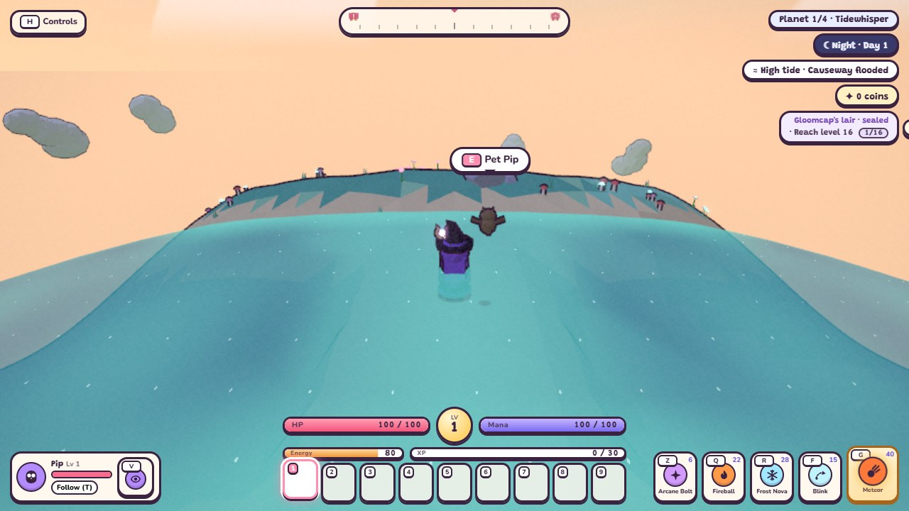
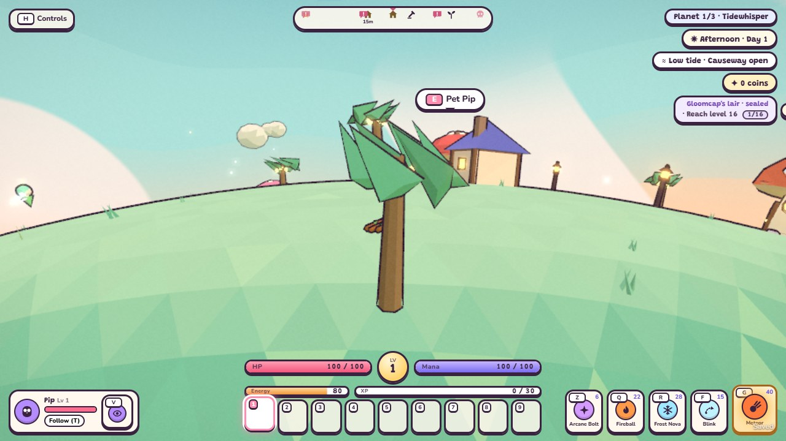
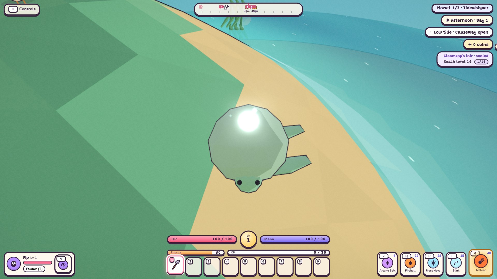
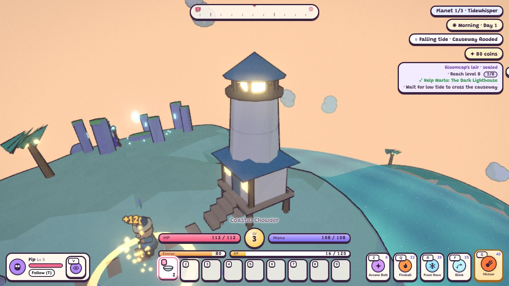
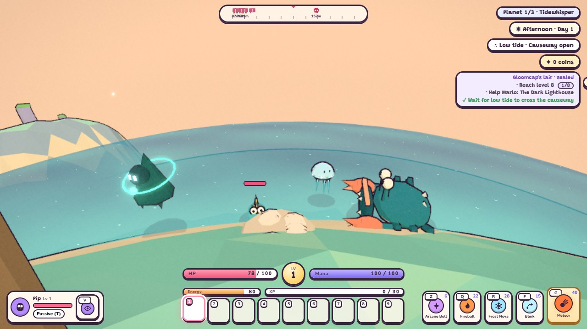
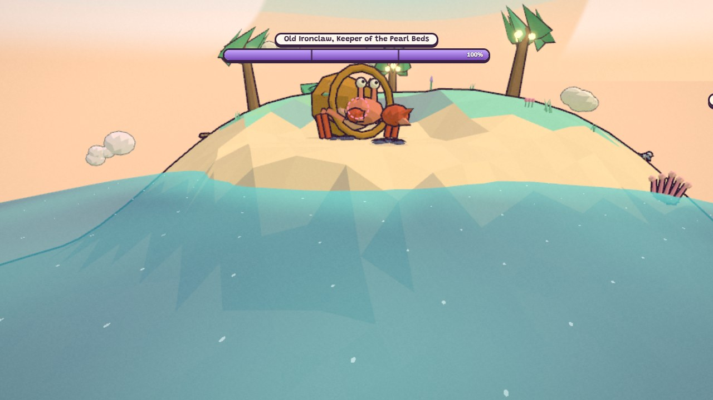
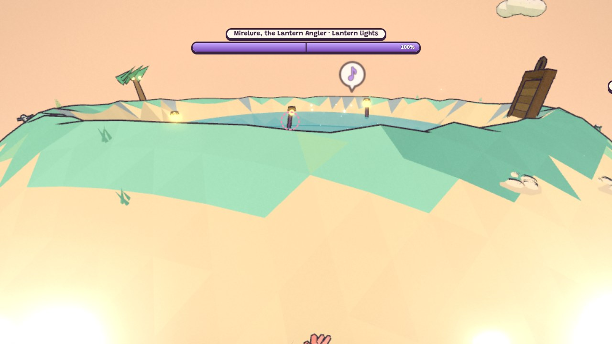
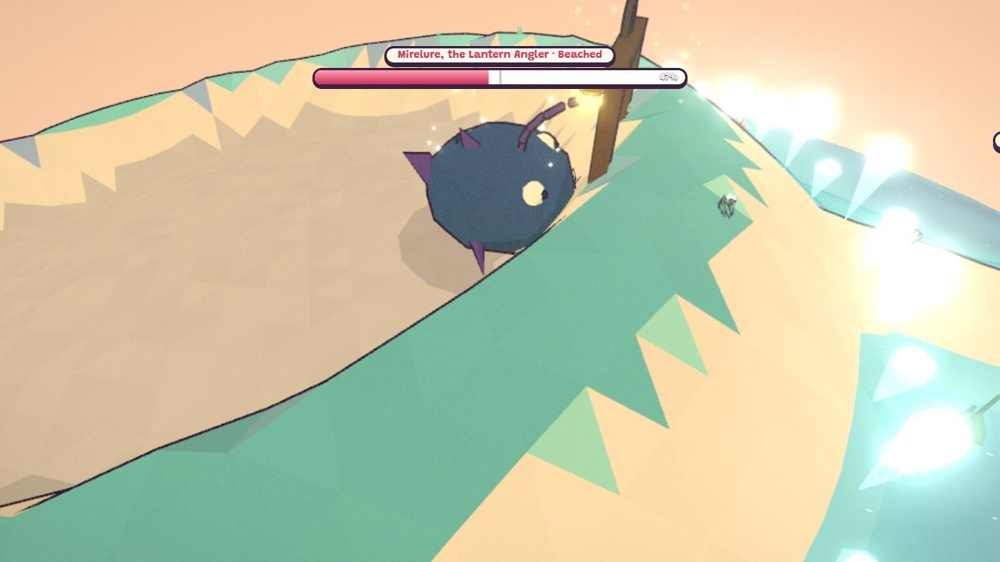
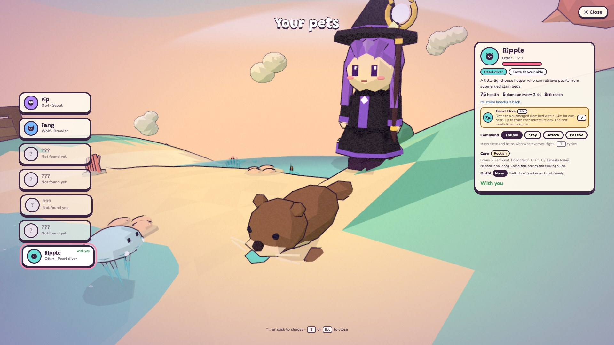

# Tidewhisper terrain and tides

## In brief (functionally complete, hardware validated, unreleased)

TODO 27h's functional content, balance, pacing and test-only campaign travel/Continue path passed again after the
TODO 29 cave merge on 2026-10-19. The clean Acer RTX 4050 acceptance matrix still failed the unchanged p95 frame
gate in all 18 cases at 1080p High on a 60 Hz display (17.4–18.2 ms versus 16.80 ms). The owner-approved gate split
allows the functional work to join `develop` while `released: false` remains in force. That earlier timing result
has been superseded for the native reference mode: a fresh Acer
matrix on 2026-10-21 passed all 18 timing and render-count cases with the otter selected in every row. The world
remains hidden because release-enabled production checks have not passed. A public `master` release also needs
owner confirmation; see the
[current release handoff](../technical/tidewhisper-release.md#fresh-reference-result-and-production-no-go-2026-10-21).

These summaries moved here from the root README; each is detailed in its section below.

Tidewhisper's unreleased economy stage adds tide-gated pearl/coral beds, shipwreck iron, washups with saved
claims, shore fishing, three coastal meals and craftable Tide gear. Dawn sea mist, rain/wind/whitecaps and a
procedural sea waltz accompany the coast. See [resources, weather and music](#coastal-resources-weather-and-music-27c).

The unreleased Tidewhisper village now has stilt buildings, a supported fishing pier, Marlo and two coastal
interiors. Restore the lighthouse with seaglass and wood; the saved quest joins level 8 and low tide as the
future boss gate. See [village and lighthouse](#stilt-village-and-lighthouse-27d).

Tidewhisper's unreleased monsters read the live tide. Shellbacks turn a barnacled plate that blocks hits from the
front, so circle round them. Jellybells drift onto the flats with the rising tide and sting in a ring, and are
stranded when it falls. Surf skippers lurk untargetable in the surf, then leap at anyone near the water.
Sea-green wisps return from Act I. See [regular enemy roster](#regular-enemy-roster-27e).

Old Ironclaw, a giant hermit crab in a sunken bronze bell, guards Tidewhisper's black pearl beds. Its bell only rings,
sending out a stunning shockwave to jump. Hit its face, catch it out of its shell at 66% and 33%, or bait a charge
across the wet sand at low tide to get it stuck. See [Old Ironclaw](#old-ironclaw-27f).

Mirelure, the Lantern Angler, hides in Tidewhisper's lagoon behind false lantern lures. Strike the lure that dims in
time with her breathing and she surfaces. At half health she smashes the sluice and is beached until the water creeps
back. Her trophy is the Tide Crown. See [Mirelure](#mirelure-the-lantern-angler-27g).

TODOs 27a-27g implement the coast, ecosystem, economy, weather, music, stilt village, lighthouse quest, regular
monsters, Old Ironclaw and Mirelure. Tidewhisper remains `released: false`: campaign release requires 27h.
The development fixture borrows encounter/resource data in the original Lanternmoss save slot to exercise real
gameplay, Continue and portals. Those borrowed definitions are test-only and do not satisfy the content gate.

The config in `src/config/planets/tidewhisper.js` describes six islands, two connecting sandbars, a lagoon,
sea-green land, sandy shores, turquoise shallows, deep blue water and a peach/aqua sky. Terrain is baked once;
changing water never changes geometry or object ids. The largest island has raised village/house sites and a
reserved farm site. Scenery, grass, farm plots and nodes respect the declared high-water envelope. The actual
stilt houses, supported pier, coastal interiors and lighthouse are implemented in 27d below.

| Development preview | Low tide | High tide |
| --- | --- | --- |
| Causeway |  |  |

`tides` is a registered mechanic. Its phase comes from the adventure calendar, with one smooth cycle per
300-second day: low at 40% (afternoon), high at 90% (night). Sea radius ranges from 71 to 72.5 metres, a total
1.5 m change. The causeway is dry at low tide and becomes deep enough to swim at high tide; swimming uses the
existing slower movement and extra energy drain. A chip beside the clock displays low/high/rising/falling tide
and whether the causeway is open. The phase freezes on title/pause, follows naps/sleep and calendar jumps, and
returns at the current calendar phase after travel. Time outside the game does not advance it.

The active instance exposes these controls for the later encounter stage:

- `status`: current level/phase/label, `causewayOpen` and `lagoonDrained`. Causeway availability is derived from
  the same live terrain/water query used by Walkers; it is not a separately saved unlock flag.
- `drainLagoon(seconds = 40)`: lower only the lagoon to radius 68.8 for a finite duration of at most one day.
  Invalid durations return `false`. Normal frames, time skips and away time expire the timer once.
- `refloodLagoon()`: cancel drainage and return the lagoon to the current tide immediately.

The lagoon is a bounded local spherical water region. Physics uses its own level instead of the surrounding
sea inside the region; the ocean shader cuts out that region and a matching cap renders its level. This lets
the exposed floor be walked on while the ocean and causeway retain their tide. The later Mirelure stage owns
boss triggers, gradual encounter reflooding, attacks and retries; 27a exposes no player-operated sluice or fight.

Only `{ drainRemaining }` is persistent, cleaned to 0–300 seconds in the existing optional v1 mechanic snapshot.
The controller supplies its calendar timestamp and away-time advancement. Save/Continue reconstructs the water
from config, saved timer and calendar before actor/resource placement. Travel/disposal removes both water meshes
and resets regions; no extra save owner or save-version bump is needed. Missing/malformed state defaults to a
normal, tide-filled lagoon.

Run `npm test`, `npm run sim`, and `node scripts/tides-smoke.mjs` with Puppeteer Core and Chromium (`CHROME`
overrides the executable). The browser helper owns port 8107, uses the low preset at 720p/1080p, checks actual
keyboard movement, swimming/energy, the chip, protected plots, local drainage, reload Continue and keyed portal
travel. It closes its own server/browser, refreshes the two development previews and keeps additional lagoon
captures in the temporary directory. `tests/sim/lib/tideFixture.mjs` is never imported by production code.

These checks verify this stage's rules and rendering; they do not certify the current desktop 60-fps release
target. Population, content, balance, complete-world browser traversal and measured performance remain 27h's
requirements. Resources/weather/music are now implemented in 27c below; the village/lighthouse are implemented in 27d below; the regular enemies in 27e below.

## Coastal flora and wildlife (27b)

The actual Tidewhisper config now selects lantern palms, kelp trees, coral fans, dune grass, sea thrift and sea
lavender. Palms carry glowing coconuts and can be chopped for wood through the existing axe/rest/regrowth flow.
Kelp leaves sway through one shared shader/time uniform; their batch bounds include the bend. Kelp and coral
are explicitly non-wood and refuse axe gathering, including direct gathering requests. Harvestable coastal
coral is gathered from exposed reef resource nodes with a pickaxe (27c).

Scenery is generated once with fixed upper counts: 18 palms, 12 kelp trees, 10 coral fans, 10 rocks and 120 small
plant clusters. Beach flora/animals reserve dry high water; kelp/coral and fish use shallow water. The static
scenery is spatially batched, and decorative quality changes do not change placement, resource ids or colliders.
The seeded development fixture measured **30,197 static scenery triangles in 65 batches**, including its borrowed
village. This geometry-cost check supplies triangle counts; target-device frame-rate acceptance is separate.

Three original ambient body builders cover crabs, turtles and seals. They share the Walker/animation/disposal
contract but are independent of combat enemies. Six hermit crabs scuttle at afternoon low tide and withdraw
into their shells when approached; flooded crabs head back to their dry home. Four sea turtles bask on beaches
by day and swim toward nearby shallows at night, then return to land. Three seals loaf on rocks, nap in the
morning/afternoon and bark when approached. The rare Pearl Turtle shares the turtle body with its own palette,
shell scutes and luminous pearl; it follows the existing slow-approach versus sprint-spooking rule.

Six ground birds alternate gull/tern plumage and wing/tail silhouettes, with one flying flock. Coastal birds
take off when flooded and keep flying until they find dry landing terrain. Three shallow shoals contain eight
fish each, plus eight emissive lanternfish visible at night: **32 fish in four instanced draws**. Fish follow the
same live sea/lagoon queries as movement, hide when water drains, freeze on pause, and dispose with their world.
They are ambient visuals; shore fishing and food are implemented in 27c, and the supported pier is implemented in 27d.

Walk up slowly and press **E** to befriend the Pearl Turtle. Its first gift is the legendary **Pearl of the Deep**
charm, which adds armor and mana regeneration. The existing adventure-wide rare-gift ledger, inventory and
equipment owners persist it in v1 saves; no new save owner/version is added. Continue/revisits may allow a later
friendship reward, as with the original rare creatures, but cannot grant a second first-gift charm. Respawning
rebuilds the turtle's swimming destination at its new shore rather than retaining its old home.
The Pearl of the Deep is marked `props.giftOnly` (2026-10-21), so it is kept out of the random gear pool: until
Tidewhisper is released, befriending the turtle is the only way to hold it. It used to be a possible tier-3 chest
drop on released Frostveil, which exposed an unreleased world's charm to players.

Verify with both full suites and `node scripts/coastal-wildlife-smoke.mjs` (Puppeteer Core/Chromium; `CHROME`
overrides the executable). The helper owns port 8108 and exercises the actual config through
`tests/sim/lib/coastalFixture.mjs`, which production never imports. It checks 720p/1080p low rendering, real palm
gathering and **E** friendship, reload Continue, charm uniqueness and night visibility; refreshes the two previews;
and keeps crab/turtle/seal captures in the temporary directory. Schedules, day/night traversal, drained-water
hiding, respawn, equipped-charm saves, quality/placement invariance and disposal are also simulated.

## Coastal resources, weather and music (27c)

The actual config generates 54 deterministic nodes: driftwood (6), shells (6), seaweed (5), seaglass (6), salt
pans (4), clam beds (6), exposed coral reefs (5), shipwreck iron (3), pebbles (6), sweetleaf (5) and black pearl
beds (2). The far beach has a reserved low-water pearl shelf for the later Ironclaw encounter. Its guard is
still 27f. Clam/black pearl beds and coral require low tide and exposed ground. Coral needs a Stone Pickaxe;
shipwreck iron needs a Copper Pickaxe. Shell beds, coral branches, salt crystals and wreck planks have procedural
models; there are no extra lights. Farm plots remain above declared high water. Squall rain waters crops using
the existing farming rule; sea mist does not.

Driftwood gives wood; Marlo's lighthouse chest gives three starter wood, and lantern palms can also be chopped.
Shell washups give shells and seaglass; seaweed and glass have their own washups. Each
washup can be claimed once per high-water crest (90% of the adventure day). Its optional `claimedCycle` field
lives in the existing gathering v1 snapshot, even after the cooldown expires. A calendar skip exposes only the
latest batch; it never creates accumulated rewards. Continue and revisits preserve claims and requested node
ids. Earlier saves without the field default to an unclaimed node. World/quality changes do not add save owners.

With a rod on the hotbar, **E** near seawater fishes using the existing bite/reeling meter. Silver sprats carry the
same fish tag as Act I catches and are the
common coastal catch and golden koi remain rare. The float follows the live tide and cancels if its water dries.
At a cooking pot, make salted fish (sprat + salt), seaweed rolls (seaweed + sprat) and coastal chowder (clams +
sprat + salt). At a forge, craft the Tide Circlet, Mantle and Boots from glass, pearls, coral and shells; a Tide
Pendant uses a black pearl, glass and shells. Since 27h they also carry forge fees (circlet 70, mantle 80, boots 70,
pendant 60 coins: 280 for the set), which Tidewhisper's chests and lighthouse quest reserve. These pieces use the existing equip/save/stat rules and are
explicitly crafted, so they cannot leak into Act I random gear rewards. Their set identity is recorded; bonuses
remain TODO 28a.

Sea mist begins at dawn and clears later in the morning. Squalls blend driving rain and strong wind into the
existing weather layers and add shader whitecaps to the ocean/lagoon, without changing the tide. The sea waltz
uses a 720 ms beat in three, over a gently modulated procedural pad. Theme changes retune existing pad voices and
replace the single melody timer; travel and repeated switching do not accumulate loops. Battle music retains
priority. The original worlds keep their cozy score.

Run both full suites and `node scripts/coastal-resources-smoke.mjs` (Puppeteer Core/Chromium, `CHROME` override).
The helper owns port 8109 and borrows only test encounters in `coastalResourceFixture.mjs`; it exercises real
E gathering, reload Continue, the three-beat audio timer, 720p/1080p low squall shaders and dry farms. Captures
are saved in the temporary directory. The simulation also covers pick tiers, low/high tide, multi-day skips,
revisits, sea fishing, dawn transitions, crop watering and equipped Tide gear Continue. These checks do not certify
reference-device frame time; that hardware measurement and campaign release remain 27h.

## Stilt village and lighthouse (27d)

Six stilt buildings and plank paths retain the shared house indices used by traveler schedules and saves. The
fishing pier has a fixed box floor above declared high water; shared Walker physics lets the hero and Marlo walk
on it without swimming. Tide water remains underneath, and normal sea fishing works from its edge. A personal
home still uses the existing home system. The two public interiors are the Saltwind Kitchen (house 1, Pim) and
Marlo's Lighthouse (house 4), with maritime decorations, notes, storage gifts and keeper lore. Other public doors
are closed in this stage. The original worlds retain their existing village generation path.

Marlo has a new keeper model/portrait and carries a lantern. He checks the lighthouse in morning/evening,
spends the afternoon at the pier and sleeps indoors at night. Traveling villagers wear beach accessories;
unhatted travelers also wear straw hats. Each traveler has a Tidewhisper arrival reaction appended after the
legacy dialogue slots, preserving old story memory.

Accept **The Dark Lighthouse** from Marlo: gather and hand over six Seaglass for the lens, then six Wood for fuel,
then speak to him to light it. Each delivery consumes its ingredients. Completion gives 80 coins, 120 XP and two
Coastal Chowders once. The lighthouse's emissive beacon follows the saved quest's completed status; it has no
extra persistent owner or point light. Partial hand-ins, completion, house gifts/lore and indoor position use the
existing v1 save systems and survive Continue and revisits. Away from Marlo, the tracker points back to Tidewhisper.

Mirelure's registered summon conditions require level 8, the completed quest and low tide. Villagers give a low-tide
hint when it is the remaining condition. The shared boss gate
reports these predicates and seals again if the tide rises before awakening. The development fixture borrows a
sealed original boss to exercise the live gate; it does not implement Mirelure. That encounter is 27g, and the
world stays unreleased. Actual low-tide causeway geometry/physics continues to come from 27a.

Verify with `npm test`, `npm run sim` and `node scripts/coastal-village-smoke.mjs` (Puppeteer Core/Chromium, `CHROME`
override). The browser helper owns port 8110 and uses `coastalVillageFixture.mjs`; production never imports the
borrowed encounter/save-slot fixture. It checks actual E acceptance/hand-ins, partial/completed reload, both
interior doors, persistent gifts and 720p/1080p low lighthouse/outfit/pier rendering, with temporary interior
captures. The simulation also checks real deck traversal, all 54 economy nodes, three gate predicates, saved
lore and Continue from inside Marlo's room. Hardware frame-time certification remains 27h.

## Regular enemy roster (27e)

The roster (`roster` in `src/config/planets/tidewhisper.js`) adds three monsters found on no other world, each with
its own behaviour module and original body, plus one returning type. Coastal groups place themselves against the
declared high water from their own stream seeded by the planet, so adding them moves no scenery, node or chest:

| Group | Count (x1.5 world scale) | Where | Module |
| --- | --- | --- | --- |
| Shellback | 3 camps of 3 (15) | `beach`: dry at high water, at most 2.5 m above it | `armoured` |
| Jellybell | 8 (12) | `shallows`: water at every tide | `drifter` |
| Surf skipper | 6 (9) | `surf`: deep at low water, dry land within 9 m | `amphibian` |
| Wisp (returning) | 3 (5) | anywhere dry, sea-green (`overrides.color` / `look`) | `ranged` |

The population (26) meets Frostveil's floor (25). Nothing spawns within the village's safe ring or the lagoon lair.

- **Shellback.** It scuttles sideways around the hero and turns its barnacled shield plate their way at a capped
  1.5 rad/s, so circling close out-turns it. The plate refuses every hit whose origin lies in a 65-degree half-angle
  cone in front: no damage, knockback or stagger, just a "BLOCKED" spark and an `enemyrefused` event. Hits from the
  sides or behind, blows landing on top of it, directionless damage (burning ground) and any hit while it is dazed
  get through. Its pinch has a warning disc in front, then a recovery in which it cannot turn.
- **Jellybell.** It floats at the surface and drifts with the measured change of the water level: up the slope onto
  the flats as the tide rises, back out as it falls (up to 0.9 m/s at the fastest tide). A shared water fence keeps
  it from swimming into water shallower than 0.45 m, so it cannot follow the hero ashore. Close in, it swells over a
  ring on the water, then stings everything in it (jump or step out). If the water drains from under it (tide, time
  skip or the lagoon), it is stranded: it cannot sting and crawls toward the nearest water, recovering the moment
  there is enough water under it again. Popped, it bursts into light.
- **Surf skipper.** Under at least 0.9 m of water it lurks submerged and untargetable, with only its fin and wake
  showing. It follows the hero along the shore without leaving the water, has to show itself in the shallows, then
  surfaces, marks a lane and leaps 6.6 m (airborne the whole way, so it clears the steep step at the waterline).
  It stays exposed on the beach for 1.8 s, then scurries back to deep water and hides. A stagger while it surfaces
  leaves it floundering for the same 1.8 s. When the tide strands it, it is visible and hittable while it hurries back.
- **Sea-green wisps** reuse the original AI with a recoloured body and glow; the original wisp is unchanged.

Behaviour modules gained two optional hooks: `steer(e, dt, dist)` overrides movement in any state (stranding, the
skipper's retreat), and `refuses(e, hitOptions)` lets a monster turn a hit away before damage. Each sea monster adds
its own extra drop roll after the usual monster drop: shells (Shellback, 50%), seaglass (Jellybell, 35%) or a silver
sprat (Surf skipper, 40%). Monsters without an extra draw no more random numbers than before. All three have bestiary
pages with attacks, counters and drops; staged pages stay out of the journal and its goals until the world releases.

Two flight fixes keep sea fights fair; the original worlds have no sea, so they are unaffected (their balance report
was rerun and matched exactly). Over the sea or lagoon, projectiles fly above the water rather than the sea bed. A
hero's aimed shot at a target out on the sea starts at, and quickly settles to, the target's height, so a skipper in
the shallows below a beach can be hit from 2 m away.

Verify with `npm test`, `npm run sim` and `node scripts/coastal-enemies-smoke.mjs` (Puppeteer Core/Chromium, `CHROME`
override; install with `npm install --no-save --no-package-lock puppeteer-core`). The browser helper owns port 8111,
seeds the play stream and advances the paused game in fixed 60 fps steps, because software rendering is too slow for
real-time checks. It checks real **Z** Arcane Bolts against the plate and the Shellback's back, a full skipper ambush
on a hero on the beach, 720p/1080p low rendering of every new body, and reload Continue, with zero page or shader
errors. The simulations (`coastalEnemies`, `coastalDuels`) cover placement and Continue determinism, plate geometry,
the capped turn, the pinch, rising/falling drift, the sting and dodging it, stranding and both recoveries, the skipper's
untargetable lurk, ambush, retreat, shore fence and stranding, extra drops, and a level-8 duel per hero. Every hero
beat every monster with no HP top-ups (3-10 s each). These are access checks; the campaign's pacing targets,
measured performance and the desktop reference frame-time target remain 27h.

## Old Ironclaw (27f)

Tidewhisper's mini boss (`miniBosses: [{ type: 'ironclaw', near: 'pearlBeach' }]`) is a giant hermit crab living in a
sunken bronze bell. It spawns on dry sand above high water, 4-14 m inland of the pearl flat reserved in 27c, and
guards the two black pearl beds there: while it lives, gathering a bed is refused and its prompt says "(guarded)".
Its kit is `src/entities/enemies/behaviors/boss/ironclaw.js` on the shared boss framework.

- **The bell** covers its back, sides and top. A hero's blow there (any hit whose origin is outside the 70-degree
  front cone, or right on top of it) is refused. After a 0.45 s glow the bell rings out a shockwave that hurts and
  dazes a grounded hero for 1 s; jump over it. It rings at most once every 3 s, and pet strikes only clang, so a pet
  cannot stun its own hero.
- **The face** (the front cone) takes 60% damage while Ironclaw is tucked in its shell.
- **Open** (+40% damage from any side, and the bell can't ring):
  - *Shell swaps* at 66% and 33%: it crawls out and scuttles about for 5.5 s, then climbs into a new shell (bronze,
    then verdigris, then a dark old bell).
  - *Wedged*: a charge that crosses wet tidal sand (dry now but under high water: the flats at low tide) ploughs it
    into the sand for 5 s. At high tide the flats are flooded, so it never wedges. It only falls for this once per
    shell: afterwards it is wary, and its charges skid to a stop at the edge of the wet sand (still shut in its shell)
    until it climbs into a new one. So a fight has at most three wedges (27h).
- **Moves**: pinch (a marked wedge in front), charge (a marked lane), and from the second shell, toll (it rears and
  slams the bell down: a shockwave to jump). Every move has a wind-up warning and a recovery.
- **Reward**: two black pearls where it falls, plus the usual mini boss treasure roll, and the beds are free. Its
  defeat is saved through the existing per-planet mini boss record, so it stays beaten through Continue and revisits.
  A faint resets the fight: it walks home, heals and returns to its first shell.

Behaviour modules and boss kits gained an optional `damageScale(e, hit)` hook (beside `refuses`) for the guarded and
open multipliers.

Verify with `npm test`, `npm run sim` and `node scripts/ironclaw-smoke.mjs` (port 8112; Puppeteer Core/Chromium as in
27e). The browser helper uses real **Z** Arcane Bolts into the bell (refused, then a ring that hurts) and its face
(lands), a low-tide charge that wedges it, 720p/1080p low rendering in and out of its shell, and its defeat surviving
reload Continue with the beds free, with zero page or shader errors. The `ironclaw` simulation covers placement and the
guard, bell zones, ring telegraph/cooldown/jump/pet rule, guarded and open damage, the pinch and charge telegraphs,
low- versus high-tide wedging, both shell swaps and the toll, the reset after a faint, loot and persistence.

`ironclawDuels` gives each hero a level-8 bot using the bestiary's plan: bait charges across the wet sand at low tide,
strike the face, and hit anywhere while it is open. It never jumps a shockwave or dodges; HP is topped up below 50%.
Every hero beat it on two seeds. In 27f most fights took 148-195 s with 8-13 top-ups, and one ranger fight took 41 s
after four early wedges. The 27h balance pass made it wary after one wedge per shell and lowered its base HP from 1000
to 800: every hero now takes 156-174 s with 6-12 top-ups, inside the 90-180 s mini boss target.

## Mirelure, the Lantern Angler (27g)

Tidewhisper's boss sleeps in the lagoon lair. She wakes when the hero reaches level 8, Marlo's lighthouse is relit and
the tide is low enough to cross the causeway (the gate registered in 27d), and the hero walks into the lagoon. The
arena ring is crashing surf (`ARENA_WALLS.surf`). Her kit is `src/entities/enemies/behaviors/boss/mirelure.js`.

- **Deep** (the lagoon is full): she stays under the water and cannot be hit. She lights three lures (four after the
  reflood), which are lair objects that can be struck. One is real. Every 1.8 s her breath rises as a ring of bubbles,
  and the real lure dims in time with it; the false ones flicker to their own beat. Strike a false lure and it bursts,
  stinging anyone right next to it. Strike the real one and she surfaces under it for 7 s, open to everything (she bites
  up close), then dives and relights. Meanwhile she sends geysers up under the hero: a marked circle, then a spout that
  tosses a hero it hits.
- **At 50%** she rises, swims to the sluice on the lagoon's rim facing the village and smashes it. Only the lagoon
  drains, through the existing local water region; the ocean and causeway keep the tide. She is beached on the floor
  and open to everything: she thrashes (a marked circle), rolls along a marked lane and bites. After 23 s the water
  creeps back over 22 s (`drainLagoon(seconds, reflood)`); once there is 1 m of water over her she dives, and four
  lures return.
- Her roll's base hit is 19 damage (38 after the fourth-world scale), keeping its peak single hit above Malgrath's
  36.75 while retaining the same warning, travel and recovery timing.
- **Retries**: a faint, walking away or a reload resets the fight. The lures go out, the lagoon refills and the sluice
  is mended, so a saved drain never outlives its fight. The win drops her treasure chest with the **Tide Crown**, once;
  Continue keeps her beaten without a second chest or crown.

The tide mechanic gained an optional gradual reflood and `activeTides()` (the live instance, for encounters). The
original drain behaviour is unchanged when no reflood is given, and the saved state only adds a bounded `reflood`
field while one is in progress.

| Lagoon at the start | Beached after the sluice break |
| --- | --- |
|  |  |

Verify with `npm test`, `npm run sim` and `node scripts/mirelure-smoke.mjs` (port 8113; Puppeteer Core/Chromium as in
27e). The browser helper checks the configured gate waking her inside the surf ring; real **Z** Arcane Bolts that burst
a false lure and surface her from the real one (it presses again on a miss, as a player would); 720p/1080p low
rendering of the lit lagoon and of her beached on the drained floor; and the win giving one Tide Crown through reload
Continue, with zero page or shader errors. The `mirelure` simulation covers the gate, the deep phase and its breath cue,
false and real lures, geysers, the sluice break and creeping reflood, beached moves, the dive to more lures, a faint,
a reload mid-drain and the reward.

`mirelureDuels` gives each hero a level-8 bot that watches her breath, strikes the lure that dims on it, and attacks her
while she is up or beached; it never dodges, and HP is topped up below 50%. In 27g every hero won on two seeds in
170-266 s, but the ranger's 171-176 s was under the 180-300 s target. 27h raised her base HP from 3000 to 3250: every
hero now takes 188-289 s (ranger 188/191, witch 273/277, knight 281/289) with 6-26 top-ups, close to the Act I bosses
(8-28). The release gate and the desktop reference frame-time measurement are still pending.

## Pearl-diving otter (27i)

Completing Marlo's **The Dark Lighthouse** quest unlocks an otter companion. It follows the existing pet commands,
levels with the hero and appears in the pet menu and character selection. Beside a submerged, ready clam bed on
Tidewhisper, **Pearl Dive** (`V`) sends the otter below the water and yields one pearl while depleting that bed.
Its tunable ability has a 14 m reach, a 90-second cooldown and a limit of two successful dives per in-game day.
Failed attempts do not spend the cooldown. Continue and world travel preserve the daily count and cooldown; a new
adventure clears them. The otter stays unavailable in normal play until Tidewhisper is released.

The candidate fixture checks the quest unlock, all three heroes, high-tide pearl yield, bed depletion, daily
limit, Continue, travel and next-day renewal with `node tests/sim/otter.sim.mjs`. `node scripts/otter-smoke.mjs`
checks real `B` and `V` input, the menu at 720p and 1080p, Continue, page and shader errors, and the otter's
rendering cost (14 meshes and 1,068 triangles). This does not certify the public 18-case hardware budget.
